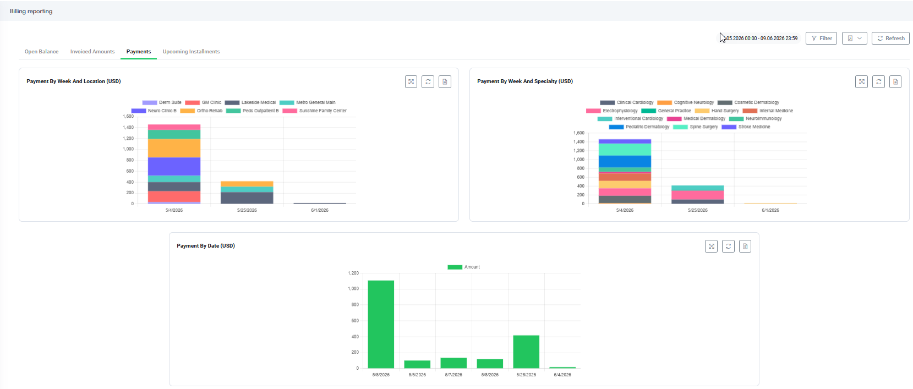
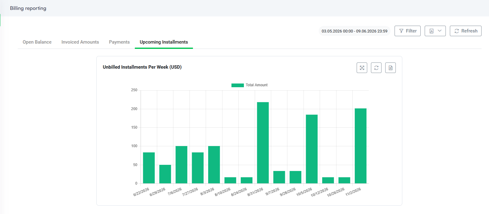

# Billing Reporting

For medical staff

The Billing Reporting dashboard provides real-time financial insights and a consolidated view of the medical services invoiced through the Patient Billing Agent. To access these analytics, select the Billing Management workspace and click **Billing reporting** from the main workspace menu.

The section is organized into four dashboards, each representing a distinct financial dimension: **Open Balance**, **Invoiced Amounts**, **Payments**, and **Upcoming Installments**. Use the tabs at the top of the page to navigate between them.

A date range filter and a Filter button are available in the upper-right corner of the page. Unless stated otherwise for a specific dashboard, the selected date range applies to all charts within that dashboard. Use the Refresh button to reload data on demand.

### Open Balance

The Open Balance dashboard shows the total amounts that have been invoiced but not yet paid, covering all medical services. It includes both generated invoices (issued and awaiting payment) and overdue invoices (past their due date). This dashboard gives your billing team a real-time snapshot of outstanding receivables, enabling proactive follow-up and cash-flow planning.


**NOTE:** The Open Balance data is not affected by the date range filter applied to the dashboard. It always reflects the complete current outstanding balance across all periods.


#### 

#### Open Balance Per Location (USD)

This bar chart breaks down the open balance by clinic or facility location. Each bar represents one location and is split into two segments:

* **Overdue** – the portion of the outstanding balance for which the payment due date has already passed.
* **Generated** – the portion corresponding to invoices that have been issued and are still within their payment terms.

Locations are displayed in descending order of total open balance, making it straightforward to identify sites that require the most immediate attention.

Clicking a bar on the chart opens a detailed view of open invoices for that specific location. From there, you can select individual records to view invoice details, preview invoice, send payment reminder or send invoice by email. For more information, see [Dashboard Drill-down Views](<Dashboard Drill down Views.md>).

#### Open Balance Per Specialty (USD)

This bar chart presents the same open-balance data grouped by medical specialty rather than by location. As with the location chart, each bar is divided into Overdue and Generated segments, allowing you to assess which specialties carry the largest outstanding balances and which portion is at risk of becoming overdue.

Clicking any bar on a chart opens a detailed view listing all open invoices associated with that specific medical specialty. From this list, you can select individual records to view invoice details, preview the patient invoice document, send a payment reminder, or directly send the invoice by email. For more information, see [Dashboard Drill-down Views](<Dashboard Drill down Views.md>).

#### Open Balance View

Below the charts, the Open Balance view lists all outstanding invoices. Each row corresponds to a single invoice and includes the following columns:

| Column   | Description                                                                                           |
| -------- | ----------------------------------------------------------------------------------------------------- |
| Number   | The unique invoice number.                                                                            |
| Account  | The patient account associated with the invoice. Click the name to open the account record.           |
| Currency | The currency in which the invoice was issued.                                                         |
| Status   | Indicates whether the invoice is **Generated** (within payment terms) or **Overdue** (past due date). |
| Due Date | The date by which payment is expected.                                                                |

Click any record to open the Invoice form, where you can send a payment reminder or email the invoice directly to the patient.

### Invoiced Amounts

The Invoiced Amounts dashboard shows the total value of invoices issued across all medical services, aggregated by week within the period selected by the date range filter. It provides a time-series view of invoicing activity, helping you track billing volume trends and identify peak periods.


**Info:** When a selected dashboard timeframe covers the current week, the charts update dynamically in real-time. As new invoices are generated throughout the day and week, their amounts are instantly integrated into the visual trends. Click the **Refresh** button at any time to fetch the latest billing data.


#### 

#### Invoices By Week And Location (USD)

This bar chart displays the weekly invoiced amounts broken down by clinic or facility location. Each bar represents one week in the selected period, with individual location series stacked to show the relative contribution of each site. This view helps you monitor whether invoicing activity at each location is consistent with expectations or shows unusual variation over time.

Clicking any bar on a chart opens a detailed view listing all invoices issued within that specific week for that clinical location. From this list, you can select individual records to inspect specific invoice details or preview the patient invoice document. For more information, see [Dashboard Drill-down Views](<Dashboard Drill down Views.md>).

#### Invoices By Week And Specialty (USD)

This bar chart presents the same weekly invoiced amounts, segmented by medical specialty instead of location. Each specialty is represented by a distinct color in the stacked bars, making it easy to compare billing volumes across specialties week over week and spot trends or seasonal patterns within specific service lines.

Clicking any bar on a chart opens a detailed view listing all invoices issued within that specific week for that medical specialty. From this list, you can select individual records to inspect specific invoice details or preview the patient invoice document. For more information, see [Dashboard Drill-down Views](<Dashboard Drill down Views.md>).

#### Total Invoices By Specialty (USD)

This summary bar chart aggregates the total invoiced amount per specialty across the entire selected period — rather than breaking it down by week. It provides a high-level comparison of specialty revenue contribution, making it useful for period-end reviews and resource allocation discussions.

Clicking any bar on a chart opens a detailed view listing all invoices issued for that specific medical specialty within the selected dashboard period. From this list, you can select individual records to inspect specific invoice details or preview the patient invoice document. For more information, see [Dashboard Drill-down Views](<Dashboard Drill down Views.md>).

### Payments

The Payments dashboard tracks the amounts actually received from patients for all medical services, aggregated within the period selected by the date range filter. While the Invoiced Amounts dashboard shows what has been billed, this dashboard shows what has been collected, enabling you to monitor payment performance and identify collection gaps.

#### Payment By Week And Location (USD)

This bar chart shows the total payments received per week, broken down by clinic or facility location. Each week's bar reflects all payments processed at each location during that week, allowing you to compare collection performance across sites over time.

Clicking any bar on the chart opens a detailed view listing all payments processed within that specific week for that clinical location. For more information, see [Dashboard Drill-down Views](<Dashboard Drill down Views.md>).

From this list, you can select an individual record to open a Payment Details form. The form allows you to review core transaction data—such as the processing status, payment method, and amount—or follow direct links to the associated patient account, medical specialty, facility location, invoice document, or installment plan.

#### Payment By Week And Specialty (USD)

This bar chart presents the same weekly payment data segmented by medical specialty. Use it to evaluate how effectively each service line is converting billed amounts into collected revenue week by week.

Clicking any bar on the chart opens a detailed view listing all payments processed within that specific week for that medical specialty. For more information, see [Dashboard Drill-down Views](<Dashboard Drill down Views.md>).

From this list, you can select an individual record to open a Payment modal. This view allows you to review core transaction data—such as the processing status, payment method, and amount—or follow direct links to the associated patient account, facility location, medical specialty, invoice document, or installment plan.

#### Payment By Date (USD)

This bar chart provides a daily-resolution view of total payments received, with each bar representing one calendar date within the selected period. Unlike the two weekly charts above, this chart is not segmented by location or specialty — it shows the aggregate payment amount per day as a single series. This chart is particularly useful for identifying specific days with unusually high or low payment activity.

Clicking a bar on the chart opens a detailed view listing all payments processed on that specific date. For more information, see [Dashboard Drill-down Views](<Dashboard Drill down Views.md>).

From this list, you can select an individual record to open a Payment modal. This view allows you to review core transaction data—such as the processing status, payment method, and amount—or follow direct links to the associated patient account, facility location, medical specialty, invoice document, or installment plan.

### Upcoming Installments

The Upcoming Installments dashboard provides a forward-looking view of scheduled installment payments that have not yet been billed. Patients who are enrolled in subscription-based payment plans make periodic installment payments for their medical services, and this dashboard helps your team anticipate the expected collection volume in the weeks ahead.

The Unbilled Installments Per Week (USD) bar chart shows the total value of upcoming unbilled installments grouped by week. Each bar represents the aggregate installment amount scheduled to fall due in that particular week, giving your billing team advance notice of expected payment volumes.

The chart extends across a multi-month horizon, enabling medium-term cash-flow planning and allowing you to proactively reach out to patients before their installment dates.


**NOTE:** The Upcoming Installments data is not affected by the date range filter applied to the dashboard. It always displays the full projection of future unbilled installments, regardless of the period selected.


Clicking any bar on the chart opens a detailed view listing all unbilled installments scheduled for that specific week. From this list, you can select an individual record to open the Payment Plan Installment modal. This modal allows you to review the exact financial breakdown of the due amount—including principal and interest values—or track core installment info such as the due date, generation status, patient account, and associated payment plan details.

