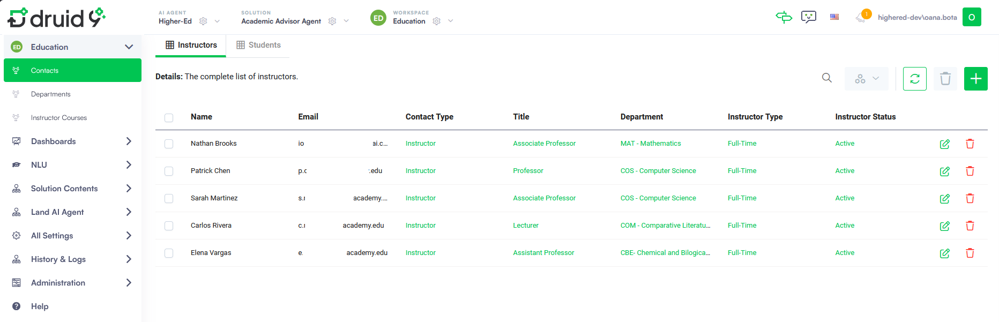

For academic staff

The Education workspace is designed for academic staff, registrars, and department managers. It provides operational access to student and instructor contact records, departmental structure, and the course catalog. Staff use this workspace to maintain accurate course, student, instructor and department data that the AI Agent relies on to respond to student requests.


**NOTE:**  Academic staff should use the solution only after the admins have imported the data of the accepted students and assigned instructors from the university systems.


## Review Enrolled Students

To see the list of enrolled students, on the main menu of the Education workspace, click **Contacts**. The list of enrolled students displays by default. You can filter student enrollment distribution by Academic Level, Department and Graduation Year using the column header filters.

## Manage Students

As academic staff, you can manage (create, update, or delete) student profiles.


**NOTE:** Whenever you create or update a student profile, always select **Student Details** from the drop-down menu in the top-left corner of the form.



A student profile includes:

- Contact details


**NOTE:** When creating a new student profile, you must set the **Contact Type** to **Student**.


- Student information

- Academic information (degrees and enrolled courses)

- Notifications (sent and received)

## Review Instructors

To see the list of instructors, on the main menu of the Education workspace, click **Contacts**, then click the **Instructors** tab. Use the column header filters to filter and sort them.

## Manage Instructors

As academic staff, you can manage (create, update, or delete) instructor profiles.


**NOTE:** Whenever you create or update an instructor profile, always select **Instructor Details** from the drop-down menu in the top-left corner of the form.



An instructor profile includes:

- Contact details


**NOTE:** When creating a new instructor profile, you must set the **Contact Type** to **Instructor**.


- Instructor information

- Academic information (taught courses) . Click the **Refresh** icon to get the latest academic information.

## Manage Academic Units

Academic units (departments) are structural components of a college or university—such as colleges, or centers—that deliver academic programs, manage curriculum, and house faculty. They are the functional, organized entities responsible for teaching, research, and awarding degrees.

While the academic staff can see the list of academic units within the institution, they can also manually add, edit or delete existing ones.

For each department, you can define their organizational hierarchy within the institution: add programs and courses per department.

### Add new academic units and define their hierarchy

To add a new academic unit and define its hierarchy:

1. On the **Education** workspace menu, click on **Departments**.
2. Click the **New AcademicUnit** icon at the top right corner of the page.
3. In the form, enter the name of the new academic units and description and save the form.

4. Click the **Programs** tab and add programs. The **Program: New Record** form appears. Follow these steps to define the program:

1. Fill in the general program details.

2. Click the **Goals & Admission** tab and define the purpose of the program, prerequisites and admission criteria.

3. Click the **Requirements** tab and define the program structure and completion criteria.

4. Save and close the program form.
5. Add as many programs as you want within the department following the procedure above.

5. Save and close the department form.

You can add courses to an academic unit (department) using the **Courses** tab in the **Academic Unit Form** or in the **Instructor Course** option on the **Education** workspace menu.  For more information see next section.

## Manage Instructor Courses

The Instructor Course catalog contains all the courses available for enrollment, including course code, title, description, schedule, associated department, prerequisites, number of seats, enrolled seats and semester availability.

To see the course catalog, on the **Education** workspace menu, click **Instructor Courses**, then click the **Instructor Course List Education** tab.

Academic staff can manually add new courses, edit or delete existing ones.

To add a new course:

1. Click the **New Instructor Course** icon at the top right corner of the page.
2. On the form, fill in the following fields:

| Field | Description |
| --- | --- |
| Name | Select the course from the dropdown. |
| Instructor | Select from the dropdown the person responsible for delivering the course. This can be a professor, lecturer, or assigned teaching staff. |
| Code | An unique identifier for the course. This field is automatically populated upon saving. |
| Description | A short summary of the course content. This field is automatically filled upon saving. |
| Prerequisites | Conditions that must be met before enrolling in the course. These can include:  - Prior courses - Program enrollment - Instructor approval |
| Department | The academic unit responsible for the course. This determines where the course is organized within the institutional structure and which programs can reference it. |
| Academic Period | The term or semester in which the course is offered. Used for scheduling and student enrollment planning. |
| Schedule | The planned timing of the course sessions. Typically includes:  - Day(s) of the week - Start and end time |
| Total Seats | The total number of seats available for this course. |
| Enrolled Seats | The number of students already enrolled in this course. This field does not require manual input, as it is automatically set to zero upon saving the form. |

3. Save and close the form.
