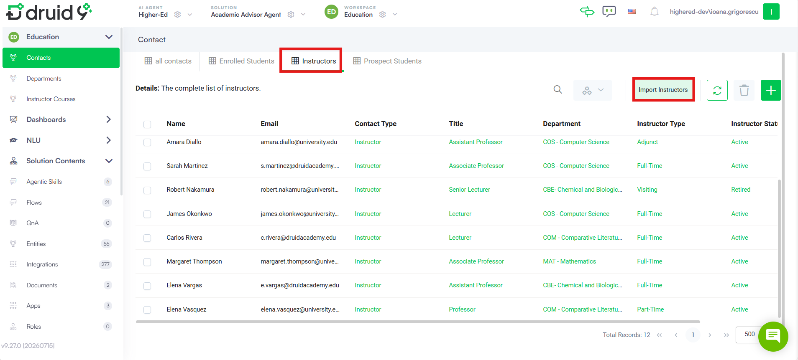
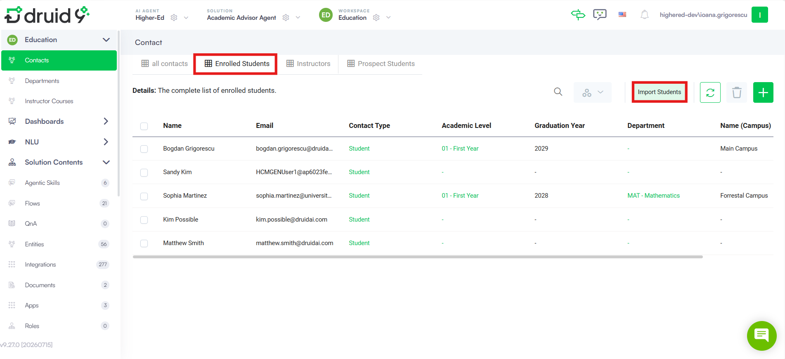
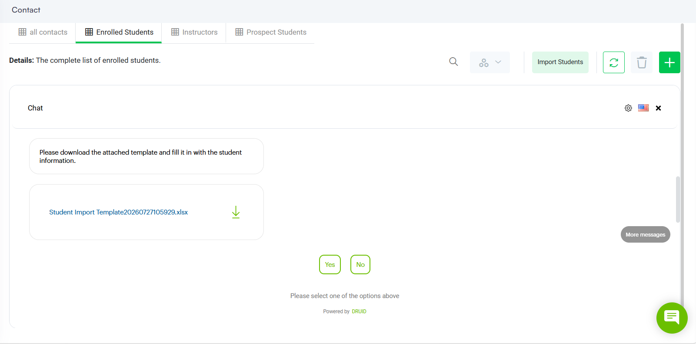

For solution admins

This section will walk you through the steps to import and configure the solution to ensure a smooth setup and operation.

## Prerequisites

- Tenant Druid community (open new tenant [here](https://www.druidai.com/license-activation)) or Druid subscription.
- You should have an AI Agent. For information on how to create an AI Agent, see [Creating AI Agents](../../../../2_AI%20Agents/Creating%20AI%20Agents.md).

- An LLM resource enabled on the tenant, or your own Azure OpenAI resource if not using the Druid Service Gateway. Minimum GPT 4.1 is required.
- The Outlook channel should be configured to enable email delivery for student and instructor notifications. For more information, see [Outlook](../../../../Channels/Outlook.md).

## Installation and Setup Procedure

Follow these steps to install and configure the solution:

### Step 1. Install the Solution from the Solutions Library

1. Go to the **Solutions Library** in the Druid Portal.
2. Search for Academic Advisor Agent.
3. Click **Import** and wait until the import status shows Success.

### Step 2. Configure App Connections

Navigate to **Solution Contents** > **Apps** and configure the following connections:

| App | Connection Details | Mandatory |
| --- | --- | --- |
| DRUID.LLM.GPT4.1 | If using your own Azure OpenAI resource, configure the endpoint and key.  **NOTE:** Minimum GPT 4.1 is required. | Yes |
| GRAPH API | Configure the Microsoft Graph credentials for the Outlook channel: client\_id, client\_secret, tenant\_id, and the email address. | Yes |

Click **Publish** to make the app connections available to the solution.

### Step 3. Configure AI Agent Special Flows

Go to the AI Agent details page and click **Dialogue Management**. Set the following special flows:

| Special Flow Name | Select |
| --- | --- |
| Welcome flow | welcome |
| Intent not found flow | switch-intent |
| Authentication flow | agent-authenticate-by-phone-number |
| Exception flow | exception-flow |
| Intent rephrase flow | rephrase-flow-notification-handling |

Save the configuration.

### Step 4. Configure NLU Intent Classification with LLM

1. Navigate to **NLU** > **Configurations** > **Intents** tab.
2. Click on **Classification Model Type**.
3. Set the **Model Type** field to **Llm**.
4. Set **Endpoint Type** to **Druid**. If you’re using your own LLM resource, select your resource instead. Then choose the **Model Name**.
5. Set the **Api Type** to **Chat Completions (Legacy)**.
6. Click **Set default** for both prompts to automatically fill in instructions.
7. Save and train the AI Agent.

### Step 5. Provision the data and configure the AI Agent personality and the institution rules

To provision all the required information for the AI Agent, follow these steps:

1. Select the **Admin** workspace.
2. Click **Education Advisor Settings** on the workspace menu.
3. Click the **Provision Data** button.

The default settings include a predefined set of values and records. You can modify and personalize existing fields to align with your institution needs.

> **IMPORTANT!**  The data provision must complete successfully before the AI Agent can process student requests. If the provisioning fails, review the app connection configuration provision the data again.

4. Click on the default settings record.
5. On the form, update the **AI Agent Name** and the **University Name**.
6. In the two prompt fields, update the AI Agent Personality rules and the University rules to accommodate your institution’s rules.

7. Save and close the form.

### Step 6. Import instructors and students (optional)

This step is optional and only required if you want to import your own instructor and student records instead of using the sample data provisioned with the solution. Run the import process twice: once for instructors and once for enrolled students.

1. Select the **Education** workspace.
2. Open the **Instructors** view to import instructors, or the **Enrolled Students** view to import students.
3. Click the **Import Instructors** or **Import Students** automation button available on the form.

4. In the chat window that opens, choose whether to download an Excel template to fill in, or to upload the Excel file you have already prepared.

5. Wait until the success message is displayed.
6. Refresh the view to display the imported instructors or students.

## Interact with the AI Agent

The Academic Advisor Agent enables students to manage their entire academic journey through natural language — no forms, no menus, no portals. Students simply describe what they want to do, and the system handles the rest.

At the heart of the solution is a central orchestrator agent, agent-university-assistant, which interprets each student message, detects intent, and instantly delegates to the most appropriate specialist sub-agent. This design keeps each component focused, reliable, and easy to maintain.

The platform supports multilingual interactions and maintains full conversational context across turns, enabling students to handle complex, multi-step academic tasks — such as exploring a program, checking schedule compatibility, and enrolling — all within a single conversation.

The following sections provide the supported use cases and example student utterances for each use case.

### Course Add - Enrollment, Schedule & Grades

| Use case | Example Student Utterance |
| --- | --- |
| Enroll in a course | I want to enroll in ECE 206. |
| Register for multiple courses | Sign me up for ECE 346 and ECE 396. |
| Check prerequisites before enrolling | Can I take COS 598I? Do I have the prerequisites? |
| Check seat availability | How many seats are left in COS 517? |
| Check schedule conflict | Does COS 510 conflict with my current schedule? |
| View weekly timetable | Show me my schedule for this semester. |
| Check current GPA | What is my GPA right now? |
| View semester grades | What are my grades for Spring 2026 |

### Course Remove- Course Drops & Withdrawals

| Use case | Example Student Utterance |
| --- | --- |
| Drop a specific course | Drop my English Literature course. |
| Withdraw from a course mid-semester | I need to withdraw from AAS 314. |
| Drop multiple courses in one session | Drop both COM 330 and COM 340 for me. |

### Academic Program Handling - Major and minor management

| Use case | Example Student Utterance |
| --- | --- |
| Declare a major | I want to declare Computer Science as my major. |
| Switch to a different major | I'd like to change my major Computer Science to Mathematics. |
| Declare a double major | Can I add Mathematics as a second major? |
| Add a minor | I want to add a Computer Science minor. |
| Undeclare a major entirely | I want to remove my declared major. |

### Program Discovery

| Use case | Example Student Utterance |
| --- | --- |
| Browse all available majors | What majors are available at this university? |
| Explore a specific department | Tell me about the Computer Science department. |
| View courses in a department | What courses does the Mathematics department offer? |
| View a major's required course path | What courses do I need to complete an A.B. in Economics? |
| Compare two programs | What is the difference between AB Degree in Computer Science and BSE Degree in Computer Science? |

When you start a conversation, the AI Agent identifies your intent and guides you through the appropriate steps. Sensitive operations require identity verification first.
