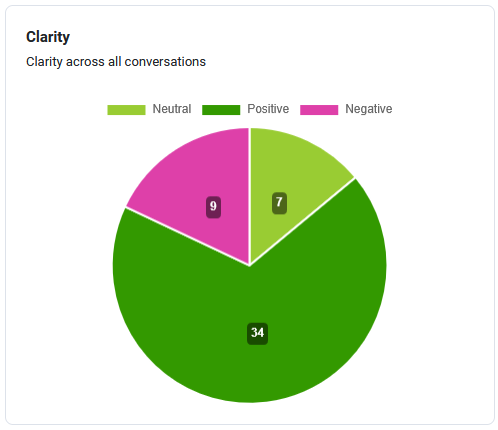
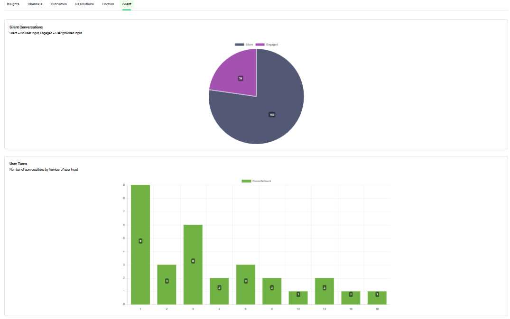

# Conversation Analytics

The **Conversation Analytics** provides deep operational insight into user interaction performance, containment, friction, sentiment, and resolution metrics across your bot instances. Use this dashboard to analyze user sentiment, detect friction points, review conversational outcome distributions, and evaluate channel effectiveness.

The AI Agent uses the metrics defined by the solution admin to perform evaluations against the specific business goals established in the Outcome Dictionary.

To access the Conversation Analytics, on the **Analytics - Conversation Toolkit** workspace menu, click **Conversation Analytics**.


**Info:** By default, the Analytics Conversations view displays data from the past 7 days. To analyze trends or specific events outside of this window, apply a time range filter to the dashboard.


### Insights Dashboard

The Insights dashboard provides a high-level, visual overview of interaction quality across all analyzed conversations. By translating raw data into actionable trends, it enables teams to assess performance, identify risk areas, and track improvements for both for both AI Agent and human-led conversations.

The dashboard is built around core experience pillars, each visualized through aggregated distribution charts.

#### Friction Chart

The Friction chart shows the presence of obstacles within conversations, based on signals detected by the AI Analyst during the interaction. Use this chart to identify dialogue elements that require optimization.

Each slice of the chart represents the number of conversations classified as:

* No Friction – Interactions that progressed smoothly with no signs of user difficulty or misunderstanding.
* Small Friction – Minor issues, such as instances requiring brief clarification or extra steps to identify the user's intent.
* High Friction – Significant obstacles, specifically triggered by conversational loops, repeated questions, or unresolved issues where the conversation ended without addressing the user's core need.

A higher proportion of friction, especially High Friction, highlights areas where conversation flows, intents, or responses require improvement.

Clicking a slice of the chart shows all conversations associated with that friction level.

From there, you can select individual conversations to view deeper analysis details. For more information, see [Dashboard Drill-down Views](<Dashboard Drill down Views.md>) and [Conversation Detailed Analysis](<Conversation Detailed Analysis.md>).

#### Sentiment Chart

The Sentiment chart provides a visual representation of the emotional tone expressed by users throughout their interactions. By analyzing the language used in each session, the AI Analyst categorizes user sentiment to help you measure satisfaction and identify service gaps.

Each slice of the chart represents the volume of conversations classified into one of three emotional states:

* Positive: The user expressed satisfaction, gratitude, or a generally positive attitude toward interaction.
* Neutral: The user showed no distinct positive or negative emotional signals.
* Negative: The user expressed frustration, dissatisfaction, impatience, or other negative emotions.

Monitoring sentiment allows you to move beyond technical success and understand the user's perception of the experience. A rising share of Positive sentiment indicates high user engagement and satisfaction. Conversely, an increase in Negative sentiment serves as an early warning sign for issues in conversation design, agent performance, or business processes.

Clicking a slice of the chart opens a detailed view of conversations with that sentiment state.

From there, you can select individual conversations to view deeper analysis details. For more information, see [Dashboard Drill-down Views](<Dashboard Drill down Views.md>) and [Conversation Detailed Analysis](<Conversation Detailed Analysis.md>).

#### Resolution Chart

The **Resolution** chart displays the percentage breakdown of how customer conversations were resolved. It helps teams monitor the overall effectiveness of AI Agentinteractions based on the AI Analyst evaluation of whether each user's primary goal was achieved.

The AI Analyst evaluates each session to determine if the user's needs were met, categorizing them into three states:

* Pass: The interaction was fully successful. The user's intent was identified, and a complete resolution or answer was provided.
* Partial Pass: The interaction was somewhat successful. The user received some information, but the goal was not entirely fulfilled, or additional steps are still required.
* Failed: The interaction did not meet the user's goal. This includes cases where the AI Agent misunderstood the request, provided incorrect information, or the user abandoned the chat due to lack of progress.

Clicking a slice of the chart shows all conversations associated with that resolution state.

From there, you can select individual conversations to view deeper analysis details. For more information, see [Dashboard Drill-down Views](<Dashboard Drill down Views.md>) and [Conversation Detailed Analysis](<Conversation Detailed Analysis.md>).

#### Interaction Volume

The **Interaction Volume** chart displays a pie chart showing total interaction volume distributed across channels (e.g., directline).

#### Clarity Chart

The **Clarity** chart helps you quickly assess how effectively information is communicated across conversations. The AI Analyst assesses the full interaction to determine if the dialogue was easy for the user to follow.

Each slice of the chart represents the number of conversations classified as:

* Positive – The conversation was clear and easy to understand, with no significant ambiguity.
* Neutral – The interaction was generally understandable but contained some unclear or incomplete responses.
* Negative – The conversation lacked clarity, causing confusion or misunderstandings for the user.

A higher share of Positive clarity indicates clearer responses and better user understanding.

From there, you can select individual conversations to view deeper analysis details.

For more information, see [Dashboard Drill-down Views](<Dashboard Drill down Views.md>) and [Conversation Detailed Analysis](<Conversation Detailed Analysis.md>).

Click any slice on the chart to see the full list of conversations for that channel.

#### Outcome Chart

The **Outcome** chart provides a percentage breakdown of how conversations were categorized based on the end result of each interaction. It gives teams an at-a-glance view of the most frequent conversation outcomes, helping identify top user intents and track how requests are being handled across the AI Agent.

Each slice of the chart represents the share of conversations classified under a specific outcome (for example, Schedule Appointment, Reschedule Appointment, or Escalated – Assistant Initiated Business Rules). Outcomes that individually account for a smaller share of traffic are grouped under Others.

Hovering over a slice displays the outcome name and the exact number and percentage of conversations it represents. Click any slice on the chart to see the full list of conversations for that outcome.

### Channels Dashboard

The Channels Dashboard tab delivers granular channel-by-channel performance tracking, evaluating containment success, escalation handoffs, drop-outs, average conversation durations, and operational peak times.

#### Containment Rate by Channel Chart

The **Containment Rate by Channel** chart displays a stacked bar chart illustrating total conversation containment split per channel.

It categorizes channel traffic into four distinct states:

* **Contained**. The AI Agent resolved the user's request without human intervention.
* **Escalated**. The interaction triggered a handoff to a live agent or secondary escalation system.
* **Abandoned**. The user closed or exited the conversation session prematurely before achieving resolution.
* **Other**

Higher containment ratios indicate that your AI Agent successfully resolves queries within the channel without forcing human handoffs or driving user drop-offs.

#### Contained Conversations Chart

The **Contained Conversations** bar chart provides outcome distributions for interactions that were completed fully by the AI Agent without requiring escalation, grouped per communication channel. It allows teams to track which specific user intents and operational workflows are successfully resolved end-to-end without human intervention.

#### Escalated Conversations Chart

The **Escalated Conversations** bar chart provides outcome distributions for interactions that required human agent handoffs, grouped per communication channel.

#### Abandoned Conversations Chart

The **Abandoned Conversations** bar chart provides outcome distribution for user interactions that were abandoned prior to completion, grouped per communication channel.

#### Average Handle Time Chart

The **Average Handle Time** bar chart provides the average conversation duration in minutes across your communication channels, allowing teams to monitor conversation efficiency.

#### Conversations by Hour / Time-of-Day Chart

The **Conversations by Hour / Time-of-Day** stacked bar chart provides session volume distributions by hour of day, grouped per communication channel. It helps identify peak operational hours and channel activity trends.

#### Time To Book

This bar chart provides conversation durations (in minutes) for successful appointment booking interactions, by appointment action type (such as scheduling or rescheduling), grouped per communication channel.


**Info:** While the business application provides this for the healthcare industry, if you do not need it, remove it from the dashboard.


### Outcomes Dashboard

The Outcomes Dashboard provides a multi-dimensional view of how conversations ended, combining outcome distribution, resolution quality, user intent, and friction signals into four coordinated charts. Together, they let you understand not just what users came for, but how well those needs were met and where experience issues are concentrated.


**Info:** By default, each chart displays a limited set of records. To view the complete list of outcomes, expand any chart to full-screen mode.


Outcomes are organized by Business Areas (e.g., Account Management, Leasing, or Insurance) and can range from broad categories to highly specific interaction results. This classification is essential for measuring performance across different departments and identifying where requests are frequently unresolved or escalated.

The solution includes as number of default Outcomes and you can customize with your specific.


**NOTE:** You can map the Outcomes with the Activity Outcome in your Contact Center System or CRM. See [Step 3. Import default settings](<Set Up the Solution.md#Step>) in the Admin section.


#### Outcome Chart

The **Outcome** chart provides a percentage breakdown of how conversations were categorized based on the end result of each interaction. It gives teams an at-a-glance view of the most frequent conversation outcomes, helping identify top user intents and track how requests are being handled across the AI Agent.

Each slice of the chart represents the share of conversations classified under a specific outcome (for example, Schedule Appointment, Reschedule Appointment, or Escalated – Assistant Initiated Business Rules). Outcomes that individually account for a smaller share of traffic are grouped under Others.

Hovering over a slice displays the outcome name and the exact number and percentage of conversations it represents. Click any slice on the chart to see the full list of conversations for that outcome.

#### Outcome & Resolution Chart

The **Outcome & Resolution** bar chart breaks down each outcome by its resolution status. Each bar represents one outcome, and the segments within it show how many conversations for that outcome resulted in:

* **Pass** – The user's goal was fully met.
* **Pass Partially** – The interaction was partially successful; some steps remained incomplete.
* **Failed** – The interaction did not resolve the user's need.

This chart is particularly useful for identifying outcomes that have a high volume but poor resolution rates, highlighting where self-service capability needs improvement or where escalation paths may need to be re-evaluated.

Click any segment of a bar to open a filtered list of conversations matching that outcome and resolution combination. From there, you can select individual conversations to view deeper analysis details.

#### Top Outcomes

The **Top Outcomes** view lists the most frequent conversation outcomes in descending order by volume, showing the outcome name and its total conversation count. This provides an immediate look at your highest-volume user needs.

#### Outcome & Friction Chart

The Outcome & Friction chart shows the friction profile for each outcome. For every outcome, the chart displays the count of conversations broken down by friction level:

* **No Friction** – The interaction progressed smoothly with no significant obstacles.
* **Small Friction** – Minor issues were detected, such as brief clarification loops or extra steps to confirm intent.
* **Other** – Conversations where friction was detected but did not fit the standard classification.

Record counts are displayed directly on each bar, so you can assess absolute volumes without needing to hover or drill in. Outcomes with a high proportion of Small Friction relative to No Friction are strong candidates for conversation flow optimization.

Click any bar segment to open the list of conversations for that outcome and friction level combination. From there, you can select individual conversations to view deeper analysis details.

#### Intent & Outcome Chart

The **Intent & Outcome** chart maps user intents on the horizontal axis to the outcomes they produced. Each bar represents one user intent (for example, New appointment, Reschedule appointment, or Billing inquiry), and the color-coded segments show the distribution of outcomes generated from conversations with that intent.

This cross-dimension view helps you answer questions such as:

* Which intents are consistently handled end-to-end versus frequently escalated?
* Are certain intents producing unexpected or undesirable outcomes?
* Where is the volume concentrated relative to the outcomes being generated?

Click any segment within a bar to open the filtered conversation list for that intent-and-outcome combination.

### Intents Dashboard

The Intents dashboard contains one chart only.

#### Top User Intents Chart

The **Top User Intents** stacked bar chart displays conversation volume distributions split by recognized user intents and resolution status (Pass, Pass partially, and Failed). It ranks intent categories by total interaction counts to help evaluate resolution success rates across specific user queries.

The **Top User Intents** bar chart displays conversation volume distributions split by recognized user intents, ranking intent categories by total conversion counts.

### Resolutions Dashboard

The Resolutions Dashboard measures the overall effectiveness of interactions by evaluating the achievement of the user's primary goal.

The AI Analyst evaluates each session to determine if the user's needs were met, categorizing them into three states:

* Pass: The interaction was fully successful. The user's intent was identified, and a complete resolution or answer was provided.
* Partial Pass: The interaction was somewhat successful. The user received some information, but the goal was not entirely fulfilled, or additional steps are still required.
* Failed: The interaction did not meet the user's goal. This includes cases where the AI Agent misunderstood the request, provided incorrect information, or the user abandoned the chat due to lack of progress.
* **Draft**: The conversation was captured but the AI Analyst has not yet completed its evaluation. Draft conversations are included in volume counts but excluded from resolution-rate calculations until processing is finalised.

The Resolutions dashboard contains three complementary visualisations that together provide both a summary view and deeper analytical breakdowns.

#### Resolution Chart

The Resolution chart is a donut chart that provides an at-a-glance breakdown of all evaluated conversations by resolution state. The percentage displayed in the centre represents the overall pass rate across the selected time period.

Each segment corresponds to one resolution state (Pass, Failed, Pass partially, or Draft), and its size reflects the proportion of conversations assigned to that state.

From there, you can select individual conversations to view deeper analysis details. For more information, see [Dashboard Drill-down Views](<Dashboard Drill down Views.md>) and [Conversation Detailed Analysis](<Conversation Detailed Analysis.md>).

#### Resolutions By Day Chart

The **Resolutions By Day** chart is a bar chart that shows how conversation volumes and resolution outcomes are distributed across each day within the selected date range. Each bar represents a single day, and the coloured segments within it correspond to the four resolution states: Pass, Failed, Pass partially, and Draft.

Use this chart to:

* Identify daily spikes in failed or partially resolved conversations that may indicate a specific event or system change.
* Track resolution-rate improvements over time after deploying dialogue updates or new AI Agent configurations.
* Spot days with an unusually high proportion of Draft conversations, which may indicate delayed processing.

Click any segment within a daily bar to open a filtered list of conversations for that specific day and resolution state.

#### Resolution & Friction Chart

The **Resolution & Friction** chart cross-references resolution outcomes with friction levels, helping you understand the relationship between conversational obstacles and whether the user's goal was ultimately met. Each bar represents a resolution state (Pass, Failed, or Pass partially), and the coloured segments within it indicate the proportion of conversations at each friction level:

* **No Friction**: Interactions that progressed smoothly with no signs of user difficulty or misunderstanding.
* **Small Friction**: Minor issues, such as instances requiring brief clarification or extra steps to identify the user's intent.
* **High Friction**: Significant obstacles, specifically triggered by conversational loops, repeated questions, or unresolved issues where the conversation ended without addressing the user's core need.

This chart is particularly useful for identifying whether Failed conversations are associated with avoidable friction. For example, a high volume of High Friction in the Failed bar signals that users experienced significant difficulty before the interaction ended without resolution — a strong indicator for dialogue optimization. Conversely, a Failed bar dominated by No Friction may suggest the intent was simply out of scope rather than a dialogue design issue.

### Friction Dashboard

The **Friction Dashboard** provides a unified view of conversational obstacles across all analyzed sessions. It consolidates friction-level summaries, intent-and-step breakdowns, and ranked views into a single dashboard, giving you both a high-level overview and the granular detail needed to pinpoint and resolve specific problem areas in your conversation flows.


**Info:** The Friction Dashboard is populated only when the **Friction Intent** is enabled by the solution administrator and the AI Analyzer has processed conversations. If automatic generation is enabled, new friction intent values may appear over time as conversations are analyzed.


#### Friction Chart

The Friction chart is a donut chart that summarises the friction profile of all evaluated conversations within the selected date range. The percentage shown in the centre is the overall friction rate — the share of conversations in which any level of friction was detected.

Each slice represents one friction level:

* **No Friction** — Interactions that progressed smoothly with no signs of user difficulty or misunderstanding.
* **Small Friction** — Minor obstacles, such as instances requiring brief clarification or extra steps to identify the user’s intent.
* **High Friction** — Significant obstacles triggered by conversational loops, repeated questions, or unresolved issues where the conversation ended without addressing the user’s core need.

A high overall friction rate, or a notable share of High Friction, signals that a significant proportion of users are experiencing difficulty — use the other components of the dashboard to identify exactly where and why. Click any slice to open a filtered list of conversations at that friction level

#### Friction Top Intents Chart

The **Friction Top Intents** chart is a grouped bar chart that visualises the intents and steps where friction most frequently occurs. Each group on the horizontal axis represents a Friction Intent (the conversational goal or topic that triggered friction), and each bar within the group represents a Friction Step (the specific moment in the dialogue where friction was detected). Bar height reflects the number of conversations in which that intent-and-step combination produced friction.


**Info:** The Friction Top Intents chart is populated only when the Friction Intent Step is enabled by the solution administrator and the AI Analyzer has processed conversations. If automatic generation is enabled, new friction step values may appear over time as the AI Analyzer processes new conversations.


Use this chart to:

* Identify which intents generate the highest absolute volume of friction conversations.
* Compare the friction steps within a single intent to determine which part of the dialogue is the primary source of difficulty.
* Spot intents where friction is spread across multiple steps, indicating a broader flow problem rather than an isolated one.

Click individual bars to filter conversations by that specific intent-and-step combination. This takes you directly to the relevant conversation list for deeper investigation.

#### Friction Events Chart

The **Friction Events** stacked bar chart tracks the daily occurrence count of friction events over time, broken down by specific user intent categories (e.g., Schedule appointment, Request bill payment, Talk with agent).

#### Friction Top Intents and Steps View

The **Friction Top Intents and Steps** view lists every intent-and-step combination in which friction was detected, ranked in descending order by the number of affected conversations. Each row displays:

* **Friction Intent** — The conversational goal or topic associated with the friction event.
* **Friction Step** — The specific dialogue step at which friction was detected for that intent.
* **# Conversations** — The total number of conversations in which that exact intent-and-step combination produced friction within the selected date range.

The view is paginated and displays up to 10 rows per page by default; use the pagination controls at the bottom of the table to navigate through the full record set.

#### Top Friction Step View

The **Top Friction Step** view provides a simplified, intent-agnostic ranking of friction steps. Each row lists a single Friction Step and the total number of conversations in which that step was associated with friction, aggregated across all intents. This makes it easy to identify the dialogue steps that are causing the most widespread difficulty, regardless of the specific user goal that led to them.

Use this table alongside the **Friction Top Intents and Steps** view to distinguish between steps that produce high friction volumes because they appear across many different intents versus steps that are problematic within a single, high-volume intent.

### Silent Dashboard

The **Silent Dashboard** helps you understand the volume and behavior of sessions in which users opened the chat interface but did not engage with the AI Agent. Separating silent sessions from active conversations is essential for accurately measuring engagement rates, identifying potential technical drop-off points, and distinguishing genuine user disinterest from cases where users may have encountered a barrier before they could type.

The dashboard contains two components:

#### Silent Conversations Chart

The Silent Conversations chart is a pie chart that shows the proportion of all sessions split into two mutually exclusive categories:

* **Silent** — Sessions in which the user opened the chat interface but did not send any message. No user input was recorded for the entire session.
* **Engaged** — Sessions in which the user provided at least one input, indicating active participation in the conversation.

The relative size of eachslice gives you an immediate read on your overall engagement rate. A large Silent slice can indicate issues such as slow widget load times, unclear entry prompts, accidental widget opens, or users who visited out of curiosity but had no immediate need.


**Info:** Silent sessions are excluded from all other dashboards (Insights, Outcomes, Resolutions, and Friction) because there is no conversation content for the AI Analyst to evaluate. Volume figures on those dashboards reflect Engaged sessions only.


Click either segment to open a filtered list of sessions in that category. Reviewing individual silent sessions can help confirm whether they share common characteristics, such as originating from a specific channel, time of day, or user segment.

#### User Turns Chart

The User Turns chart is a bar chart that shows the distribution of Engaged sessions by the number of user inputs they contained. Each bar on the horizontal axis represents a specific turn count, and the bar height shows how many conversations reached exactly that number of user messages.

Use this chart to understand conversation depth and engagement patterns across your users:

* High volume at low turn counts (1–2 turns) — Suggests many users send a single message and then abandon the conversation. This may indicate the AI Agent’s first response is not meeting expectations, or that users are testing the widget rather than seeking a resolution.
* A gradual long tail — A typical healthy distribution. Most conversations resolve within a moderate number of turns, with progressively fewer conversations requiring many exchanges.
* Unexpected spikes at higher turn counts — A cluster of conversations requiring a large number of turns may indicate a dialogue loop, a difficult-to-resolve intent, or an area where the AI Agent consistently fails to understand the user on the first attempt. Cross-reference with the Friction Dashboard to investigate further.


**Info:** Combine the **User Turns chart** with the **Friction Dashboard** to determine whether high-turn conversations are correlated with specific friction intents or steps. A high average turn count in conversations that also show High Friction is a strong signal for dialogue redesign.

