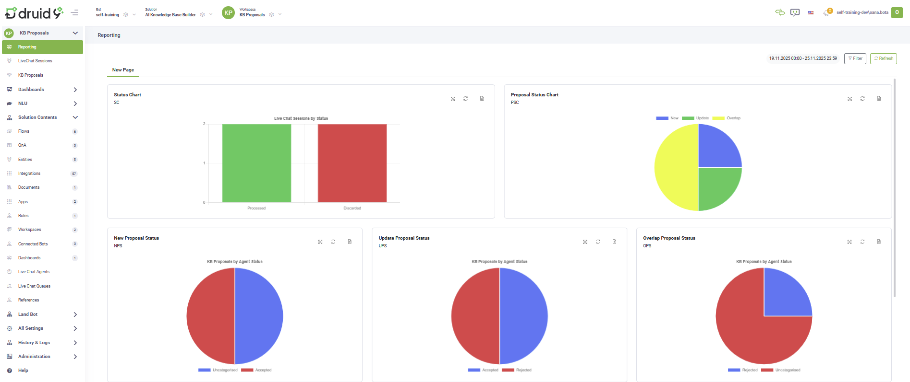

# AI Knowledge Base Builder

The **AI Knowledge Base Builder** is an add-on for the **Live Chat Advanced** solution designed to automatically create and maintain your company’s Knowledge Base using real customer conversations. Powered by GPT-4.1, it analyzes live chat interactions between customers and human agents and automatically generates potential Knowledge Base articles (KB proposals). Each proposal includes a suggested question and a detailed answer extracted from real interactions.

The AI-generated article proposals are evaluated against existing Knowledge Base content and categorized as:

* **New** - There is no current content in the Knowledge Base for the topic.
* **Update** - The Knowledge Base contains related content, but the proposal offers more accurate or more complete information.
* **Overlap** - The Knowledge Base content matches the generated proposal.

A Knowledge Base Administrator can review and validate these proposals from a dedicated business workspace to update the company Knowledge Base.

### Key Components

The key components of this solution include:

* Druid Data Service back-end that handles data storage and processing.
* Two dedicated workspaces:
* **Admin** workspace – Used by solution administrators to manage standard data lists such as session statuses, proposal statuses, and LLM prompts.

* **KB Proposals** workspace – Used by Knowledge Base administrators to review and validate AI-generated proposals.

* Automatic database provisioning to prepare required tables and structures.
* An AI-driven alert flow that processes new Live Chat sessions at predefined intervals and generates Knowledge Base proposals.

### Business Workflow

1. **Session Logging**. All Live Chat sessions are automatically logged in a Data Service table when a human agent connects to an end-user.
2. **Analysis and Extraction**. An alert flow runs at predefined intervals, analyzing all new Live Chat sessions. It extracts relevant business topics and saves them in a separate table, KBProposal.
3. **Proposal Categorization**. Each KBProposal is checked against the existing Knowledge Base to verify if an answer already exists for the solution provided by the human agent. The proposal is then categorized as New, Update, or Overlap.

4. **Review and Action**. A Knowledge Base content administrator reviews all proposals in a dedicated Workspace, choosing to Accept or Reject each one.

When a proposal is Accepted, it is added to the Knowledge Base. The Knowledge Base is automatically trained, and the new answer becomes available immediately.

5. **Reporting**. A reporting dashboard is available to analyze the output and status of the AI Knowledge Base Builder solution.

### Prerequisites

* Tenant Druid community (open new tenant [here](https://www.druidai.com/license-activation)) or Druid subscription.
* A AI Agent. For information on how to create an AI Agent, see [Creating AI Agents](https://self-training-dev.comm.eu.druidplatform.com/docs/Content/3_Bots/Creating%20Druid%20Bots.htm).
* API resources enabled for DruidWebView and Druid Data Service.
* Druid LLM API resources must be activated for GPT 4.1. Contact your Druid sales representative to enable these resources and generate an API token.
* The Live Chat Advanced solution installed and configured. For more information, see [Setting up Live Chat](<../../../Live Chat/Setting up the Live Chat Starter.md>).

### Configuring the Skill Template

#### Step 1. Install the solution from the Solutions Library

Go to the Solutions Library, search for solution "AI Knowledge Base Builder", and import it.

Wait until the import status shows as “Success”.

#### Step 2. Configure app connections

Go to **Administration** > **Druid Services** and check if you have the Druid Service Gateway resources provisioned for gpt-4.1. If they are not provisioned, contact a Druid Admin to generate those resources.

If Druid Service Gateway resources are provisioned, go to **Solution Contents** > **Apps**. The provided connections are already configured since they use the credentials already provisioned on the tenant.

| App           | Description                                                           | Provisioning                                                                                                                                                                                                                                                                                                                                  |
| ------------- | --------------------------------------------------------------------- | --------------------------------------------------------------------------------------------------------------------------------------------------------------------------------------------------------------------------------------------------------------------------------------------------------------------------------------------- |
| DRUID.LLM.4.1 | Used for analyzing the LiveChat sessions and extracting KB proposals. | Provisioned by DRUID.                                                                                                                                                                                                                                                                                                                         |
| KB-REST       | Allows the AI Agent to add answers to the Knowledge Base.             | The username and password of a Druid user account. In the **Base URL** field, enter the url specific to your environment: - **Community**: \*.community.druidplatform.com/api - **Production West Europe**: \*.druidplatform.com/api - **Production US**: \*.us.druidplatform.com/api - **Production Australia**: \*.au.druidplatform.com/api |

You can also change these connections and add your own LLM resources.

Click **Publish** to make the apps available.

#### Step 3. Set the AI Agent special flows and enable KB usage

1. Go to the AI Agent details page and click the **Dialogue management** section header.
2. From the **Welcome flow** dropdown list, select **setup-flow**. This flow automatically triggers the provisioning workflow when a new chat starts, ensuring all standard data is initialized.

.png>)

3. Scroll down and turn on the **Use Knowledge Base** toggle.
4. Save the AI Agent.


**Info:** As part of the Live Chat setup, make sure the Live Chat special flows are configured correctly. For more information, see [Setting up Live Chat](<../../../Live Chat/Setting up the Live Chat Starter.md>).


#### Step 4. Prepare the standard answer Knowledge Base

1. Navigate to **NLU** > **Knowledge Base**.
2. Click the **Add new** button.
3. Enter the data source **Name**. Use a name other than “AI Generated DataSource,” which is automatically created by the AI Agent.
4. Choose **Structured Documents** as the data source **Type**.
5. Upload the [sample Excel file](../../../Solution%20Library/Agentic%20Solutions/Operational%20Tools/https:/druiddocs.file.core.windows.net/docs-shares/Rebranded/AI%20in%20everyday%20life.xlsx) or your own set of standard answers.
6. Set the **Min score threshold** to **30** and **Target match score** to **60**.
7. Click **Create**to create the data source.
8. Click **Extract** to extract the data, then **Train** to train the data source.

#### Step 5. Enable the AI-driven alert flow

The **get-unprocessed-conversations** flow processes new Live Chat sessions and generated Knowledge Base proposals. To set this automation to run at predefined intervals, for instance daily at 8 AM, you must configure the alert:

1. Go to **Solution Contents** > **Flows**.
2. Click on **get-unprocessed-conversations** alert flow.

3. In the Flow Diagram, from the **Actions** menu, click the **Info** icon to view the current flow details.

4. Click the **Scheduling** tab.
5. Add a static subscriber. This must be a chat user who has previously interacted with the AI Agent on the webchat channel.

6. Click the **Schedule** section and select **Is scheduler enabled**.
7. Set the schedule based on your requirements.

8. Save the flow.

The flow will now run automatically at the scheduled intervals, processing new Live Chat sessions and generating Knowledge Base proposals without further intervention.
