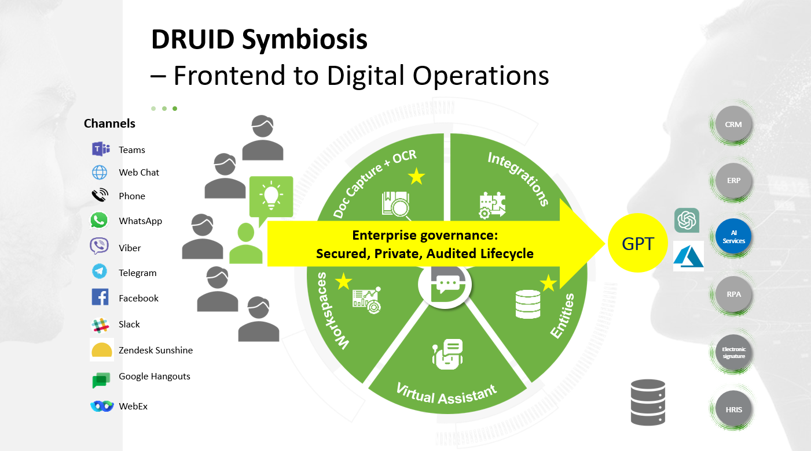
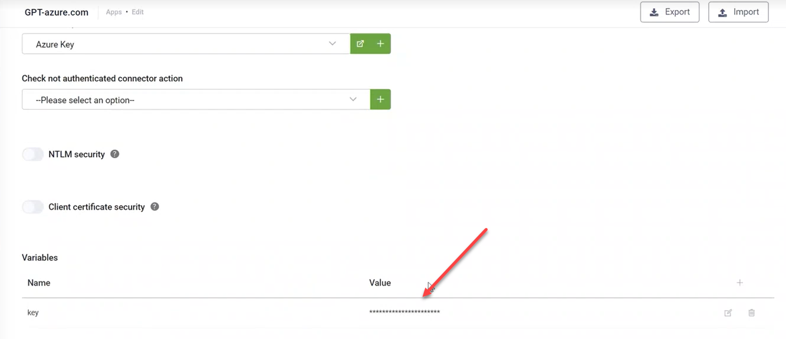
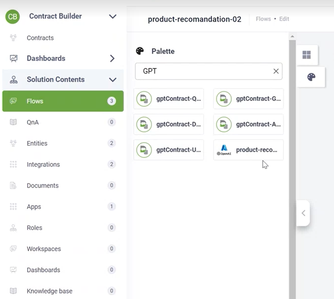
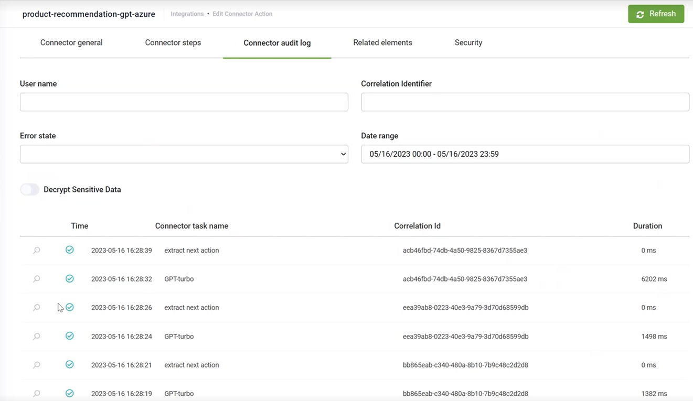
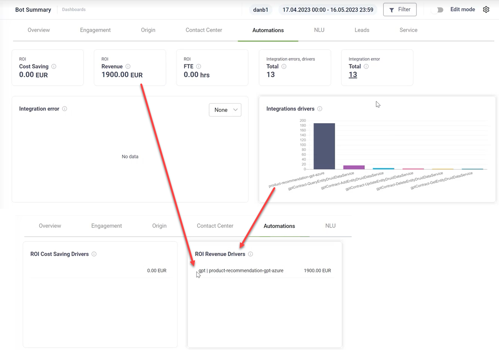

# ChatGPT

DRUID technology is an AI and digital hub, which enables you to create end-to-end conversational business applications (conversational or traditional by using web views and forms in digital workspaces) powered by GPT technology.

To use GPT technology in DRUID, integrate with Azure OpenAI, build prompts that provide the ChatGPT AI model with instructions and the business context and then consume the prompts in conversational flows or in web views and forms.

DRUID security layers guarantee the data governance, secure applications management with authoring RBAC and provide authors with extensive audit logs. Creating DRUID conversational business applications using GPT technology enables you create conversational business applications that are enterprise-ready and compliant:

* **GDPR compliance: Data privacy and data storage**. The calls DRUID makes to the ChatGPT are stateless; Druid does not train and validate the data captured from the prompts neither does it push any data into the GPT model. DRUID uses the Prompt and completion approach. In integration with Microsoft Open AI service, the [data privacy and compliance is guaranteed](https://learn.microsoft.com/en-us/legal/cognitive-services/openai/data-privacy).
* **Governance**. Only authorized people are authoring GPT prompts in a controlled environment. With DRUID authoring experience, you make sure that only designated people within your enterprise have access to define the connection to the GPT service (e.g. a private Azure Cloud subscription with OpenAI) and provide the key in a fully secure way (the key value is obfuscated in the DRUID platform).

The prompt developers can build prompts and consume the key of your GPT service without having direct access to the GPT service.

Using DRUID granular access rights (authoring RBAC) your DRUID administrator can grant the right people within your enterprise with the rights to build or/and consume prompts (via integrations).

For example, authors can consume the prompts defined in integrations in the conversational flows.

* **Fully transparent logging**. With the connector audit logs, you can see all the calls sent to GPT.

* **GPT Return Of Investment**. Easily identify the ROI generated by using the GPT technology by using analytics tagging on GPT integrations (connector details, section Analytics).

The following DRUID features enable GPT business applications:

* Conversation flow - Code Editor
* Custom Code integrations
* Secured deployment architecture
* Sensitive data encryption
* Analytics
* Knowledge Base
* Workspaces
* Data Service
