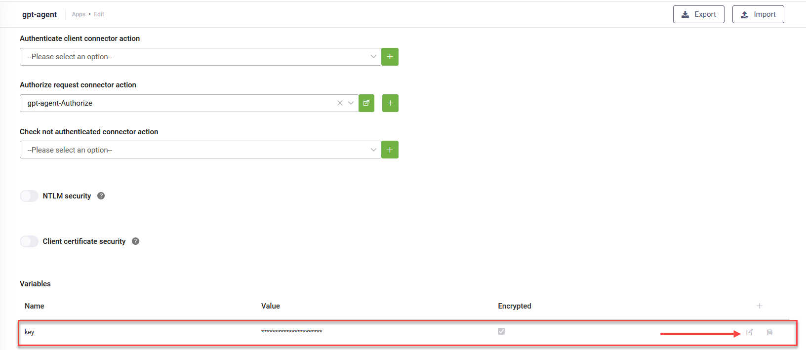

# GPT Agent Template v2

The GPT Agent Template v2 is an enhanced solution for building fully functional AI Agents using the new Agentic framework. It serves as a starting point for developing business Agents that handle user interactions efficiently.

### Solution Components

The solution includes the following components:

* **GPT Conductor Template** – An example GPT-enabled workflow that routes user intents to the appropriate Agent based on the business problem. It directs questions to either the GPT Agent Template or the Small Talk Agent Template.
* **GPT Agent Template** – An example of a fully functional GPT-powered Agent that manages simple ticketing tasks. It understands user issues, runs a conversation to collect the necessary information, and creates tickets in a back-end system..
* **GET Solver Function Template** – An example of a solver function for the GPT Agent that retrieves information from external systems and provides it as context to the Agent. You can extend this function by integrating custom data retrieval connectors and passing the retrieved data as a response to the GPT function.
* **POST Solver Function Template** – An example of a solver function for saving data in external systems. You can customize this function by adding your own data insert connectors, using the values collected by the GPT Agent as input parameters.
* **Small Talk Agent Template** – An example of a GPT-enabled workflow designed to handle generic user questions that do not require specific business context.
* **Welcome Template** – A simple welcome flow that also runs the database provisioning process the first time the AI Agent is launched.
* **GPT Setup Workspace** - An admin workspace where you can modify GPT prompts and Agent functions. At runtime, Agents will use the configured scripts to process interactions.

### Prerequisites

* Tenant Druid community (open new tenant [here](https://www.druidai.com/license-activation)) or Druid subscription.
* You should have a AI Agent. For information on how to create an AI Agent, see [Creating AI Agents](<../../2_AI Agents/Creating AI Agents.md>).
* Enable the API Resources for Druid WebView and Druid Data Service. Then, activate the Druid Data Service in your tenant by navigating to **Administration** > **Settings** > **Druid Data Service**, and selecting **Is enabled** and clicking the **Save all** button at the top right of the page.

### Configuring the SolutionTemplate

To configure the solution template, follow these steps:

#### Step 1. Install the solution from the Solutions Library

Go to the Solutions Library, search for solution "GPT Agent Template v2" and import it following the instructions provided in section [Installing Solution Templates](<../Installing Solution Templates.md>).

Wait until the import status shows as “Success”.

#### Step 2. Configure apps connections

Go to solution Apps and configure the **gpt-agent** connections with your the Base URL and API key for your deployment of the GPT-40 Mini model, either from Azure or OpenAI.


**Info:** You can use any other LLM that supports tools/function calling.


After you configure the connections, click **Publish**.

#### Step 3. Set up the AI Agent special flows

Go to the AI Agent settings, Details page and click the Dialog management section header. The section expands. Select the following special flows:

| Special Flow         | Select                 |
| -------------------- | ---------------------- |
| Welcome flow         | welcome-template       |
| Intent rephrase flow | gpt-conductor-template |

Scroll down and click **Save & Close**.

#### Step 4. Run database setup workflow

Open a new web chat to start a conversation with the AI Agent. The assistant will first run a setup workflow to add all required GPT prompts in Druid Data Service. Once the setup is complete, you can view and modify the prompts in the "GPT Setup" workspace.

Once the setup is complete, you can start talking to the Agent.
