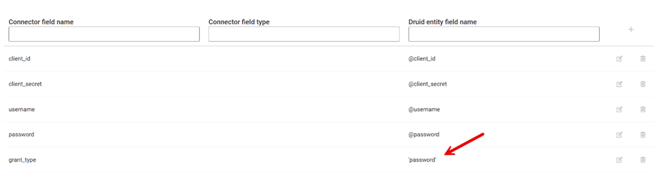

<a id="ServiceNow"></a>


This topic explains how to configure a DRUID REST app and integration tasks for ServiceNow integration. It covers authentication and supported API operations (GET, POST, PATCH).

<a id="AuthenticationwithOAuthCredentials"></a>

## Authentication with OAuth Credentials

To authenticate with ServiceNow, you'll need the following information:

- **Base URL**: The URL of your ServiceNow instance.
- **Client ID**: From your ServiceNow OAuth configuration.
- **Client Secret**: From your ServiceNow OAuth configuration.
- **Username**: A service account user.
- **Password**: Password for the service account.
- **Grant Type**: password




<a id="GenerateOAuthCredentials"></a>

## Generate OAuth Credentials

To obtain the Client ID and Client Secret:

1. In your ServiceNow instance, go to **System OAuth** > **Application Registry**.


2. Register a new OAuth application.


Use a dedicated service account for DRUID integration. Assign it permissions to:

- Read
- Create
- Update
- Delete incidents

3. Save the generated credentials.

See [ServiceNow documentation](https://www.servicenow.com/docs/bundle/yokohama-security-management/page/product/secops-integration-sir/secops-integration-splunk-addon/task/configure-application-registry-splunk.html) for detailed instructions.

The following sections provide the required endpoints and parameters for various ServiceNow REST API operations.

<a id="CreateanIncident"></a>

## Create an Incident

**API Resource URL**

```
POST {{BaseUrl}}/api/now/table/incident
```

**Request body**

```
{
  "caller_id": "",
  "category": "{{category}}",
  "short_description": "{{short_description}}",
  "opened_by": "6816f79cc0a8016401c5a33be04be441",
  "comments": "{{comments}}",
  "cause": "{{email}}",
  "active": "true"
}
```

<a id="GetIncidentInformation"></a>

## Get Incident Information

**API Resource URL**

```
GET: {{BaseUrl}}/api/now/table/incident?sys_class_name={sys_class_name}&sysparam_view={sysparam_view}&sysparam_limit={sysparam_limit}&number={number}&sysparm_display_value=true
```

<a id="GetIncidentsbyUser"></a>

## Get Incidents by User

**API Resource URL**

```
GET: {{BaseUrl}}/api/now/table/incident?sys_class_name={sys_class_name}&sysparam_view={sysparam_view}&sysparam_limit={sysparam_limit}&sysparm_display_value=true
```

<a id="UpdateanIncident"></a>

## Update an Incident

**API Resource URL**

```
PATCH {{BaseUrl}}/api/now/table/incident/{sys_id}
```

**Request body**

```
{
  "description": "test",
  "close_code": "Resolved by caller",
  "close_notes": "Closed"
}
```
