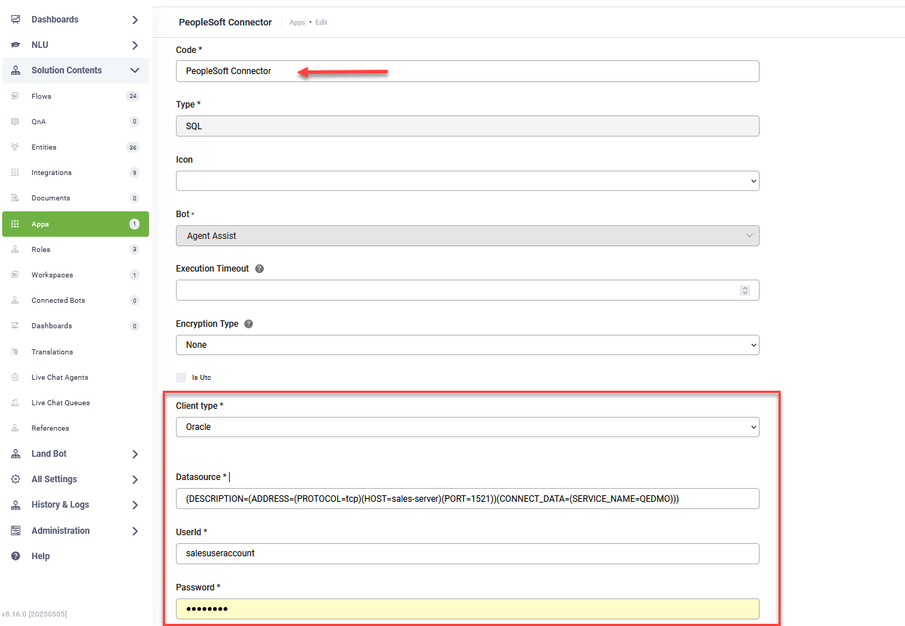

---
layout:
  title:
    visible: false
---

# PeopleSoft

This section explains how to configure a DRUID SQL app to integrate with PeopleSoft.

Follow these steps to create an SQL app for connecting to your PeopleSoft environment:

1. From the solution menu, click **Apps**. The Apps page appears listing the connection strings created for the selected solution.
2. Place the cursor at the top-right corner of the page on **Create App**. A drop-down appears
   .
3. Click **SQL**.

The Edit Connector page appears.

4. Provide the details listed in the table below.

| Field | Description |
| --- | --- |
| Code | Unique name to identify the App. You will reference in each Integration you call from this SQL App.  E.g., PeopleSoft Connector. |
| Icon | Select the icon that best describes the app. It helps you easily identify the app in the list of apps. If no icon is selected, DRUID default icon per selected app type will be shown in the apps list. |
| Execution Time | The maximum number of seconds a request is allowed to execute. By default, the timeout for all connector integrations is 60 seconds. This setting will apply to all connector tasks which use this app.  **IMPORTANT!** To avoid long execution time for an integration with many tasks, the maximum sum of all timeouts configured on an integration is 250 seconds. Whenever this maximum is reached, the execution of the currently running integration task is interrupted and any subsequent integration tasks are no longer executed. |
| Encryption Type | Enables data encryption on the connector using the AES CGM encryption algorithm and allows authors to encrypt specific data before sending it to external SQL apps, by using the Encrypt Data integration task as first task in the desired connector action.  When you select AES CGM encryption algorithm (the only one currently available), two new options are available:   - **Encryption Key** – click the **Generate** button to generate the key, which will be used by the Encrypt Data task to encrypt the data and by the client / 3rd party application to decrypt the data and use it further. - **Secure encryption with salt** – adds a random 64-bits salt to the data before encrypting it. Please note that using this feature requires the client to develop code for data decryption.   For more information, see [Encrypt Data](../../../../7_Integrations/Encrypt%20Data/EncryptData.md). |
| Client type | Select **Oracle**. |
| Data source | Enter the connection string based on the Oracle DB connection details that you have:   - for SID:   `(DESCRIPTION=(ADDRESS=(PROTOCOL=TCP)(HOST=<the name of the server where your database is running>)(PORT=<the port number for your database (the default port number for Oracle databases is 1521>))(CONNECT_DATA=(SID=<the unique name of your DB instance>)))` - for Service Name: `(DESCRIPTION=(ADDRESS=(PROTOCOL=<the protocol of the listener. E.g., TCP>)(HOST=<the host name or IP address of the computer>)(PORT=<the listening port number>))(CONNECT_DATA=(SERVICE_NAME=<alias to a DB instance used when connecting>)))` |
| User and Password | The credentials (user name and password) of your SQL Server account. |
| Additional Connection Parameters (Optional) | **Syntax**:  `<Connection Parameter>``=``<value>``;` `<Connection Parameter>``=``<value>``;` `<Connection Parameter>``=``<value>`  For information on the available connection parameters, see [Additional Connection Parameters](#Additional_Connection_Parameters). |

5. Click **Save and Close**.

Add the desired SQL integrations that use the code of the previously created SQL app.

## Additional Connection Parameters

| Connection Parameter | Description |
| --- | --- |
| Connection Lifetime | Minimum life time (in seconds) of the connection. |
| Connection Timeout | Minimum time (in seconds) to wait for a free connection from the pool. |
| Context Connection | Returns an implicit database connection if set to true. |
| DBA Privilege | Administrative privileges: `SYSDBA` or `SYSOPER`. |
| Decr Pool Size | Number of connections that are closed when an excessive amount of established connections are unused. |
| Enlist | Controls the enlistment behavior and capabilities of a connection in context of COM+ transactions or `System.Transactions`. |
| HA Events | Enables ODP.NET connection pool to proactively remove connections from the pool when an Oracle database service, service member, instance, or node goes down. Works with Oracle Global Data Services, including Oracle RAC, Data Guard, GoldenGate, and some single instance deployments. |
| Load Balancing | Enables ODP.NET connection pool to balance work requests across Oracle database instances based on the load balancing advisory and service goal. Works with Oracle Global Data Services, including Oracle RAC, Active Data Guard, and GoldenGate. |
| Incr Pool Size | Number of new connections to be created when all connections in the pool are in use. |
| Max Pool Size | Maximum number of connections in a pool. |
| Metadata Pooling | Caches metadata information. |
| Min Pool Size | Minimum number of connections in a pool. |
| Persist Security Info | Retrieval of the password in the connection string. |
| Pooling | Connection pooling. |
| Promotable Transaction | Indicates whether or not a transaction is local or distributed throughout its lifetime. |
| Proxy User Id | User name of the proxy user. |
| Proxy Password | Password of the proxy user. |
| Self Tuning | Enables or disables self-tuning for a connection. |
| Statement Cache Purge | Statement cache purged when the connection goes back to the pool. |
| Statement Cache Size | Statement cache enabled and cache size, that is, the maximum number of statements that can be cached. |
| Validate Connection | Validation of connections coming from the pool. |
