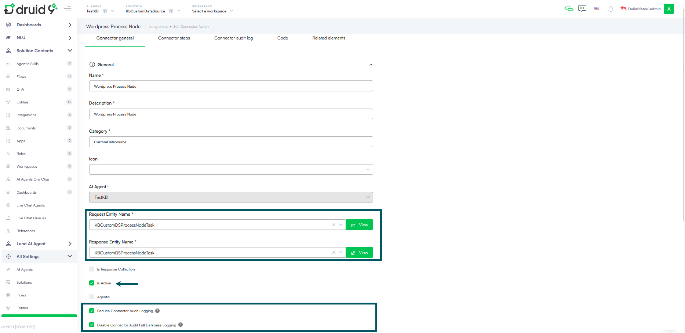

Custom data sources allow you to extract data from third-party systems that expose data via APIs. These sources support integration responses and help retrieve content when none of the standard DRUID data source types apply.

Custom data sources can include databases, where each table represents a node, and table content represents records (such as articles). You can also use them to extract data from systems like Confluence, Zendesk, and Salesforce Ticketing/KB.


**NOTE:** Druid supports video file extraction. For requirements, limitations, and how the extraction works, see [Extracting Data from Video Files](<Extract Data from Video Files.md>).


## How custom data sources work

Custom Knowledge Base (KB) data sources enable Druid to access and retrieve data from external systems using DRUID integrations (DRUID Connectors). This approach leverages Druid existing hybrid deployment capabilities to securely access on-premise data sources.

To create a custom data source, you need to configure two key processes (integrations):

* **Crawl Integration** – Responsible for discovering and retrieving the structure (nodes and hierarchy) of the data source, including file nodes.
* **Extract Integration** – Responsible for extracting the actual content from the files identified and retrieved by the Crawl Integration.

### The crawling process

The crawling process is iterative, meaning it repeats until a specific condition is met. It starts at a defined point in the data source and retrieves nodes for each hierarchy level. This process continues, exploring each level of the hierarchy, until one of the following occurs:

* Crawl Depth limit reached. The crawling process reaches the maximum depth level specified in the crawling configuration.
* No more child nodes available. The crawling process reaches a point in the hierarchy where a node has no further child nodes.

For example:

* **Depth = 1**: The integration runs once at the root level (level 0) and retrieves all direct child nodes of the root.
* **Depth = 2**: The integration runs ONCE for the root node (level 0) and then once for each of its direct child nodes (level 1), to discover the subsequent children of level 2, for each child in level 1. If the root node has 10 child nodes, the integration executes 11 times in total (once for the root and once for each child node).


During each execution, the crawling integration populates the request entity with the data of the currently processed level. This request entity includes the parent node’s ID, specifically the value of **\[\[KBCustomDSDiscoverTask]].ParentNode.Id**, which is essential for correctly establishing the hierarchical relationship between nodes in the data source. It ensures that each discovered child node is correctly associated with its parent in the response returned by the integration.

Iterating through the discovered hierarchy of nodes is controlled by the Knowledge Base engine itself. You don’t need to implement logic for iterating through the hierarchy in the crawling integration. The crawling integration should focus only on returning the child nodes of a single given parent node. The crawling engine will further call the integration for each parent node, depending on the requested depth and the number of parent nodes.

### The extraction process

The extraction process focuses on retrieving the content from the nodes identified during crawling. The Extract integration is executed once for each node of the data source, discovered in crawling stage, and as such, it is designed to deliver the content of a single node per execution.

The KB Engine orchestrates this by invoking the Extract integration for every node, populating the request entity with the relevant information for that specific node.

For example, if the crawling process discovers 15 nodes under the root, the KB Engine will execute the Extract Integration 15 times, once per node, to extract their respective content.

## Set up custom data sources

This section describes how to set up a custom data source.

### Step 1: Create an integration for node crawling

To create a crawling integration:

1. Add an integration action (**Integrations** > **Create connector action**). For information on how to create a connector action, see [Defining the Integration Actions](https://druidai.gitbook.io/druid-ai-docs/integrations/enterprise-connectors/defining-the-integration-actions). When defining the connector action:

* For both **Request Entity Name** and **Response Entity Name**, select the **\[\[KBCustomDSDiscoverTask]]** entity.
* Check both **Reduce Connector Audit Logging** and **Disable Connector Audit Full Database Logging**. This helps prevent performance issues and heavy database loading.


2. Create an integration task for crawling. Add a custom code integration task and other integrations to accommodate your use case (REST, SQL, SOAP, etc.).


**NOTE:** The crawling integration must exclusively use the dedicated system entity **\[\[KBCustomDSDiscoverTask]]**; otherwise, it will not appear in the data source configuration panel.


3. Define the crawling logic.

**Crawling logic template**

```
(function main() {
    // Request Entity manipulation
    let requestEntity = Context.GetRequestEntity();

    // When Request Entity has not been initialized in the context, its value is null
    if (requestEntity == null) {
        Context.RaiseError("01", "Request entity is empty. Contact technical support.");
        Context.CompleteAction();
    }
    
    let nodes = EntityFactory.CreateCollection("KBWebsitePage"); // Initialize the Nodes array to hold the discovered nodes

    // Execute the API call to retrieve data from the external source
    Context.ExecuteTask("<Task name>"); // Calls the actual API that loads data from the external data source
    let responseEntity = Context.GetResponseEntity(); // in this example, we map the Name, the URL and the externall ID (ExternalObjectId) of each node directly in the API call response

    // Add additional technical metadata to each node
    if (responseEntity.Nodes != null && responseEntity.Nodes.Count > 0) {
        for (let i = 0; i < responseEntity.Nodes.Count; i++) {
            let node = responseEntity.Nodes[i];

            let newNode = EntityFactory.CreateEntityByName("KBWebsitePage"); // Create a new node

            // ExternalObjectId and ExternalObjectType are used together to uniquely identify an object in the external system.
            newNode.ExternalObjectId = node.Id; // Id of the object in the external system.
            newNode.ExternalObjectType = "item Type"; // Type of the object in the external system.
            
            newNode.PageType = 1; // 1 - Repository File (this notifies the system that this is a file with content that can be extracted); 2 - Repository Folder (this notifies the system that this is a folder that can contain other files/folders).
            newNode.ContentMimeType = "node mime type"; // Set the appropriate content MIME type based on the file extension

            /* 
            In order for the system to extract/re-extract the content of the node, the following properties can be used: Modified, ContentLastModified, ContentHash. 
            These properties are used to determine if the content of the node has changed since the last extraction. If any of these properties indicate a change, the system will re-extract the content.
            1. Modified: Set this to true if the node has been updated/changed in the source system.
            2. ContentLastModified: Set this to the last modified timestamp of the content in ISO format (e.g., "2025-01-21T13:45:00Z").
            3. ContentHash: Set this to a hash value (e.g., SHA256) representing the content. If the content changes, the hash should also change.
            None of this properties are mandatory, but it is recommended to set at least one of them to ensure proper content extraction management.
            */
            
            newNode.ContentLastModified = node.Date; // ISO timestamp example - typical value from APIs like WordPress REST API "modified_gmt". Ex: "2025-01-21T13:45:00Z"
            newNode.ContentHash = node.Etag; // Example SHA256 content hash - this is usually provided by the API or computed by external system

            newNode.Modified = true; // Boolean — this notifies the system that this node has been updated/changed in the source system and that the content needs to be extracted or re-extracted again (default value: false). It is recommended to use ContentHash or ContentLastModified so the system only re-extracts content when necessary (when the content has actually changed). Use Modified only when re-extract is decided by user.         
            
            newNode.Context = { Author: node.Author }; // Custom metadata can be added to the Context property as a JSON object. This metadata will be stored and provided during content extraction.

            nodes.Push(newNode); // Add the newly created node to the Response Entity's Nodes array

            // │ File Type  │ MIME Type                                                                 │
            // ├────────────┼─────────────────────────────────────────────────────────────              ┤
            // │ .docx      │ application/vnd.openxmlformats-officedocument.wordprocessingml.document   │
            // │ .pdf       │ application/pdf                                                           │
            // │ .doc       │ application/msword                                                        │
            // │ .xls       │ application/vnd.ms-excel                                                  │
            // │ .xlsx      │ application/vnd.openxmlformats-officedocument.spreadsheetml.sheet         │
            // │ .xlsm      │ application/vnd.ms-excel.sheet.macroEnabled.12                            │
            // │ .pptx      │ application/vnd.openxmlformats-officedocument.presentationml.presentation │
            // │ .ppsx      │ application/vnd.openxmlformats-officedocument.presentationml.slideshow    │
            // │ .csv       │ text/csv                                                                  │
            // │ .json      │ application/json                                                          │
            // │ .mp4       │ video/mp4                                                                 │
            // │ .mp3       │ audio/mpeg                                                                │
            // │ .eml       │ message/rfc822                                                            │
        }
    }

    responseEntity.Nodes = nodes; // Set the Nodes array in the Response Entity
    responseEntity.Status = 1; // Possible values: 1-Complete, 2-NextPage, 3-Error. Complete → set this to 1 to stop the iteration for the given level (in case the data is retrieved by pagination)
    Context.SetResponseEntity(responseEntity);

    Context.CompleteAction();
})();
```

4. Save the integration and publish it.


**NOTE:** The crawling context is automatically sent between successive calls by the platform.


How this template script works:

1. **Retrieves the request entity from the crawling context**. If the request entity has not been initialized in the context, an error message is displayed and the process stops.
2. **Initializes the nodes collection**. The script initializes an empty KBWebsitePage collection that stores all discovered nodes for the current task execution.
3. **Executes a discovery task to fetch data**. Calls an external task (for example, Wordpress Discover Sites) to retrieve data from the source system, such as WordPress pages or files. The results are stored in the response entity.
4. **Adds comprehensive metadata to each node**. For each discovered node, it creates a new KBWebsitePage entity, maps the external data (Name, URL), and assigns technical metadata (External Object ID, Page Type, MIME Type). Crucially, it sets Modified, ContentLastModified, or ContentHash to help the Knowledge Base engine detect content changes and ensure efficient content re-extraction.
5. **Completes the response entity**. Sets the status of the current level to complete (`responseEntity.Status = 1`), indicating that all nodes at this level have been discovered (for example, when pagination is not used).
6. **Sends back the response**. Returns the response entity to the Knowledge Base engine so it can continue building the knowledge tree.

### Step 2: Create an integration for data extraction

To create an extraction integration:

1.  Add an integration action (**Integrations** > **Create connector action**). For information on how to create a connector action, see [Defining the Integration Actions](https://druidai.gitbook.io/druid-ai-docs/integrations/enterprise-connectors/defining-the-integration-actions). When defining the connector action:

    * For both **Request Entity Name** and **Response Entity Name**, select the **\[\[KBCustomDSProcessNodeTask]]** entity.
    * Check both **Reduce Connector Audit Logging** and **Disable Connector Audit Full Database Logging**. This helps prevent performance issues and heavy database loading.

    
2. Add a REST integration task to retrieve content files from the third-party system.


**NOTE:** The extraction integration must exclusively use the dedicated system entity **\[\[KBCustomDSProcessNodeTask]]**; otherwise, it will not appear in the data source configuration panel.


3. Save the response in **\[\[KBCustomDSProcessNodeTask]].**. Set **Project Result To Entity Path** to **\[\[KBCustomDSProcessNodeTask]].**.



**Info:** The most efficient way to extract data from third-party systems, you can configure the extraction integration to construct JSON content as per the Druid structured JSON format. This allows structured content from external systems to be processed efficiently. Save the response in a JSON file. For details on the structure of the JSON file, see [JSON File Structure](<Custom Data Sources.md#JSON_File_Structure>).


4. Add a custom code task to extract the content from the previous response and store it inside FileContent in the corresponding KB node (file node).

**Data Extraction custom code template**

```
(function main() {
    let responseEntity = EntityFactory.CreateEntityByName("KBCustomDSProcessNodeTask");
    responseEntity.Node = EntityFactory.CreateEntityByName("KBWebsitePage");
    responseEntity.Node.Context = {};
    responseEntity.Node.Context.FileContent = Context.GetResponseEntity().Node.Content;
 
    Context.SetResponseEntity(responseEntity);
    Context.CompleteAction();
})(); 
```

You can add additional integration tasks for example to use generative AI for rephrasing content.

### Step 3. Create a custom data source

To create a custom data source:

1. In the Knowledge Base page, click **Add Data Source**.
2. Enter a name and select **Custom** as the data source type.
3. From the **Crawl integration** field, select the integration created for crawling.
4. From the **Extract integration** field, select the integration created for extraction.
5. Click **Save**.

Once the custom data source is set up:

1. Click **Crawl** to start the crawling process and retrieve all nodes and child nodes.
2. Click **Extract** to run the extraction integration and extract content from the external system.

You can choose which file explorer elements Druid will extract information from during the extraction process. To exclude an element from scraping, click the three dots icon next to it, and then select **Exclude**. To include a previously excluded element, click the three dots icon next to it, and then select **Include**.

## JSON File Structure <a href="#json_file_structure" id="json_file_structure"></a>

For Custom data sources, third-party tools must support REST APIs for data exchange. Extracted content — whether in Word documents, Excel files, PDFs, or JSON format — must be mapped into a structured JSON file before integration.

The JSON file should follow this format:

**JSON structure**

```
[
  {
    "Title": "Sample Title",
    "Content": "Content 1"
  },
  {
    "Title": "Sample Title 2",
    "Content": "Content 2",
    "PageNumber": "3"
  },
  {
    "Title": "Sample Title 3",
    "Content": "Sample Content 3",
    "SheetName": "Sheet1"
  }
]
```

The following table provides the description of each JSON property:

| Property   | Required | Description                                                                                                             |
| ---------- | -------- | ----------------------------------------------------------------------------------------------------------------------- |
| Title      | Yes      | The title of the content entry.                                                                                         |
| Content    | Yes      | The content to be added to the Knowledge Base.                                                                          |
| PageNumber | No       | Relevant only when mapping data from PDFs or Word documents. Specifies the page number where the content was extracted. |
| SheetName  | No       | Relevant only when mapping data from Excel files. Specifies the sheet name where the content was extracted.             |

## Related Topics

* [Advanced Features and Optimization](<Advanced Features and Optimization.md>)
* [Data Management and Schedules](<Data Management and Schedules.md>)
