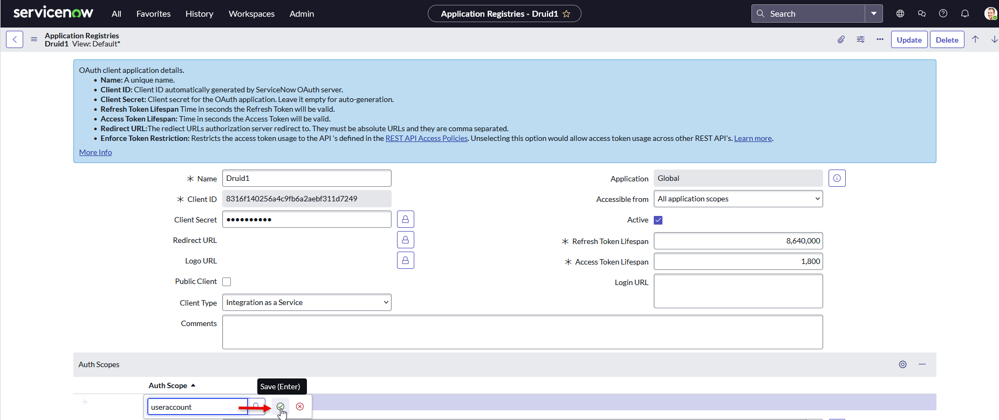

You can add data from your ServiceNow knowledge base to your AI Agent Knowledge Base.

## General Prerequisites

* You have a ServiceNow developer account. If you don't have one, create it [here](https://developer.servicenow.com/).
* You have already built a ServiceNow instance.
* Your developer account has permissions to register apps.
* You have a published AI Agent.

## Add Data from ServiceNow to the Knowledge Base

This section explains how to add a ServiceNow data source and extract data from the ServiceNow Knowledge Base.

### Step 1. Create OAuth client in ServiceNow

If you want to authenticate with OAuth when creating your ServiceNow data source, you need to create an OAuth client:

1. Log into the [ServiceNow developer portal](https://developer.servicenow.com/).
2. Click the **Start building** button.

3. Your ServiceNow instance opens in a new browser window.
4. In the **All** menu, search for 'Application registry' and click on it.

.png>)

5. The Application Registries page appears.
6. Click the **New** button.

7. Click on 'Create an OAuth API endpoint for external clients'.

8. Enter a **Name** and in the **Client secret** field, enter a password.
9. Copy the **Client ID**, you will need it in the Druid Portal.
10. Enter a password in the **Client Secret** field and save it securely. You will need this value later in the Druid Portal.
11. From the **Client Type** drop-down, select **Integration as a Service**.
12. In the Auth Scopes table, double-click on _Insert new row_, enter **useraccount** and save the record.

13. In the **OAuth Application User** field, enter the name of the user to which the OAuth app binds for client credential flow. Note that in this field you see only active users who haven been granted the roles **rest\_service** or **web\_service\_admin**.

14. Click the **Submit** button.


**Info:** As a best practice, create a dedicated integration user for each external client, e.g. “oauth\_integration\_druid”, give it only the roles **rest\_service** (Internal Integration User) and **web\_service\_admin** (Web service access only), and select it as your **OAuth Application User**.

 


### Step 2: Create the data source

To begin, follow the step-by-step instructions in [Data Source Creation](<Data Source Creation.md>). In the Add New Data Source modal, make the following settings:

1. From the **Type** drop-down, select **ServiceNow**. After you select the type, the content of the page displays additional fields required for adding a ServiceNow data source.
2. Authenticate with ServiceNow. You can authenticate using Basic Authentication or OAuth:

* **Basic Authentication**:

1. From the **Authentication type** field, select **Basic**.
2. Enter the credentials (Username and Password) of a ServiceNow user with roles **rest\_service** and **web\_service\_admin**.

* **OAuth**:

1. From the **Authentication type** field, select **OAuth**.
2. Enter the **Client ID** and **Client Secret** from your ServiceNow OAuth client.

3. In the **URL** field, provide the ServiceNow Instance Base URL.

To get the Instance URL, follow these steps:

1. Log into the [ServiceNow developer portal](https://developer.servicenow.com/).
2. Click on the **Manage my instance** button.

3. Copy the **Instance Base URL**. **Do not use the Copy icon**, as it does not copy the full Base URL.

4. The **View endpoint** field is prefilled with **kb\_view.do?sysparm\_article={0}**.
5. In the **Discovery table** field, the default value is **kb\_knowledge?workflow\_state=published**. This table is used by the KB Engine to crawl only published articles.
6. In the **Content table** field, enter the name of the ServiceNow table from which the KB Engine will extract data.

If left empty, content will be downloaded from the view endpoint for each article (only if the page is public).

7. In the **Discovery batch size** field, change the number of items extracted per page if needed.
8. In the **Content JSON paths** field, specify the JSON paths to extract content from the response when querying the content table. Example: result.text, result.kb\_question, result.kb\_answer.


**Info:** If not specified, the entire content will be used.


9. Click **Create**.

### Step 2. Crawl the data source

Click the **Crawl** button at the top-right corner of the data source page. Wait until the crawling process finishes. This prepares the data for extraction.

### Step 3. Extract the data

Click the **Extract** button at the top-right corner of the data source page. Wait until the extraction process completes.

### Step 4. Train the data source

To ensure the KB Engine can search through the data source paragraphs, train your data source after extraction.

## Related Topics

* [Advanced Features and Optimization](<Advanced Features and Optimization.md>)
* [Data Management and Schedules](<Data Management and Schedules.md>)
