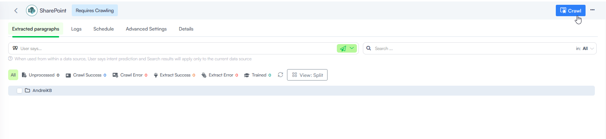

You can add a SharePoint data source to the KB, enabling the extraction of paragraphs from Excel, Word, and PDF documents within SharePoint site libraries.


**NOTE:** Druid supports video file extraction. For requirements, limitations, and how the extraction works, see [Extracting Data from Video Files](<Extract Data from Video Files.md>).


## General Prerequisites

To connect Druid to SharePoint Online, your Microsoft Azure subscription administrator needs to create in Entra an app registration and a client secret and provide Druid with the following details:

* Tenant ID
* Client ID
* Client Secret


To create the app registration, see the official [Microsoft documentation](https://learn.microsoft.com/en-us/entra/identity-platform/quickstart-register-app).

To create the client secret, see the official [Microsoft documentation](https://learn.microsoft.com/en-us/entra/identity-platform/how-to-add-credentials?tabs=client-secret).

Depending on the SharePoint content, you want to grant Druid access to, specific configurations are required.

### API Permissions for Content Filtering

If you intend to use user permission-based content filtering, ensure your app registration is granted the **Sites.FullControl.All** SharePoint REST API permission.

While the system includes a fallback to the Microsoft Graph API, this fallback is limited to resolving identities within Entra ID. It cannot resolve SharePoint-native groups (e.g., Site Members, Owners, or Visitors), which may result in users being incorrectly denied access to content.

## Granting Druid Access to All SharePoint Content

To allow Druid access to all content in your SharePoint, your Azure administrator must:

1. Navigate to **MS Azure > SharePoint File Discovery**.
2. Grant the **Sites.Read.All** API permission.


## Granting Druid Access to a Specific SharePoint Site using PowerShell

The Druid Knowledge Base SharePoint crawler uses the Microsoft Graph API to fetch content. Your Microsoft Azure subscription administrator needs to grant the **Sites.Selected** Graph permission to the registered app.


Grant admin consent for MSFT.


The final permissions list should look similar to the figure below.


Granting the **Sites.Selected** permission does not provide immediate access to SharePoint content. Instead, it acts as a gateway that requires manual site collection assignment.

Your Azure subscription administrator must explicitly grant at least "read" permission to the app registration for each specific site collection. Use the following PowerShell script to perform this grant.

Before running the script, ensure you have the following values:

* **Tenant ID**: Found in your Azure portal overview.
* **App ID**: The Client ID of your registered application in Entra.
* **Site ID**: Accessible via https://.sharepoint.com/sites//\_api/site/id.

Copy the following script in your preferred text editor and replace the three values, then run the script in PowerShell:

**PowerShell Script**

```
#Install-Module -Name Microsoft.Graph -Scope AllUsers #Install the Graph module if needed. Restart PowerShell ISE after this one.

$yourTenantId = '11111111-2222-3333-4444-555555555555' #Replace with your Tenant ID
$grantedToAppId = '11111111-2222-3333-4444-555555555555' #Replace with your App ID
$siteId = '11111111-2222-3333-4444-555555555555' #Replace with your Site ID

#Once you execute a cmdlet the underlying module is auto-loaded. You just need to make sure the required modules are installed.
Connect-MgGraph -Scopes "Sites.FullControl.All" -TenantId $yourTenantId #Set your tenant id here. You will be prompted for tenant admin credentials.

$graphUrl = "https://graph.microsoft.com"
$permission = "read"
$displayName = "Druid SharePoint Access" #Replace with your preferred description

# Prepare body for permission request
$body = @{
   roles = @($permission)
   grantedToIdentities = @(
    @{
     application = @{
      id          = $grantedToAppId
      displayName = $displayName
     }
    }
   )
  } | ConvertTo-Json -Depth 3

  # Actually grant permission
Invoke-MGGraphRequest -Method POST -Uri "$graphUrl/v1.0/sites/$siteId/permissions" -ContentType "application/json" -Body $body
```

## Granting Druid Access to a Specific SharePoint Site using Postman

For site-specific access, your Azure administrator needs to create two app registrations in the Microsoft Azure Portal:

* **Main app**: Used to assign permissions (e.g., `ManagerApp`).
* **Client app**: Used to access the SharePoint site content (e.g., `ClientApp`).

To grant access to a specific SharePoint site:

1. Get the main app ID and write it down. You’ll need this later.


2. Get the main app secret id and write it down. You’ll need this later.


3. Grant API Permissions to the main app. Assign the **Sites.FullControl.All** permission in Microsoft Graph to the main app.


4. Get the client app ID and write it down. You’ll need this later.


5. Get the client app secret and write it down. You’ll need this later.


6. Grant API Permissions to the Client App. Assign the **Sites.Selected** permission in Microsoft Graph to the client app.


7. Configure SharePoint permissions. To simplify the process, you can this [Postman collection](https:/druiddocs.file.core.windows.net/docs-shares/SalesforcePostmanCollection/Sharepoint%20permission%20configuration_PostmanCollection.json) to make the required API calls:
8. Get the access token. Make a `POST` request to the following API using the main app registration (`ManagerApp`) to obtain an access token:

`https://login.microsoftonline.com/{tenant_id}/oauth2/v2.0/token`


2. Get site id. Make a GET request to the below url by using the above token for authentication as a Bearer token:

`https://graph.microsoft.com/v1.0/sites/companyname.sharepoint.com:/sites/sitename`

You will obtain an id formed from `{hostname},{siteCollectionId},{siteId}` (E.g., "id":"companyname.sharepoint.com,c5acaa50-8617-2c1a-a68c-6c92f7649d29,6a3638b2-5683-4221-82e9-6e701eb1c318"), take only the **siteCollectionId** (e.g., c5acaa50-8617-2c1a-a68c-6c92f7649d29) and use it in the following steps (**siteId**).


3. Assign site permissions. Make a `POST` request to the following API using the access token from the previous step:

`https://graph.microsoft.com/v1.0/sites/{siteId}/permissions`

Replace the `{siteId}` with the value you copied at step 7.b for the **siteCollectionId**.


## Adding SharePoint data sources and extract data

This section describes how to add a SharePoint data source and extract paragraphs from documents stored in SharePoint libraries.


**NOTE:** You can authenticate with SharePoint in two ways: using a SharePoint client secret or a Druid-generated certificate. If you want to authenticate with SharePoint by using a Druid-generated certificate, you should follow the procedure described in section [Authenticate with SharePoint by using a DRUID-generated certificate](<SharePoint data sources.md#Authenticate_with_SharePoint_by_using_a_DRUID-generated_certificate>) before adding the data source; otherwise, verifying the data source credentials at creation time will fail.


### Step 1: Create the data source <a href="#step_1-_create_the_data__source" id="step_1-_create_the_data__source"></a>

To begin, follow the step-by-step instructions in [Data Source Creation](<Data Source Creation.md>). In the Add New Data Source modal, make the following settings:

1. From the **Type** drop-down, select **SharePoint**. After you select the type, the content of the page displays additional fields required for adding a SharePoint data source.
2. In the **Content Location (URL)** field, provide the URL of the SharePoint site from which Druid will extract data.

To find the SharePoint Content Location (URL), follow these steps:

1. Right-click on the desired site library/folder/document in Microsoft SharePoint and select **Details**.


2. In the right-side panel, click More details.


3. Scroll down the right-side panel until you locate the **Path** field, and then click the copy icon next to it. This is the **Content location (URL)**.


3. In the **Source type** field, select either **Sharepoint online** or **Sharepoint 2019**.
4. Enter the **Tenant Id** and **Client Id**.
5. For SharePoint 2019, you can crawl sites and subsites from a specific library by entering the library path in the field **Document library path**.
6. You can authenticate with SharePoint Online in two ways: using a SharePoint client secret or a Druid-generated certificate.

* **Client Secret**: Enter the client secret provided by your Microsoft Azure subscription administrator in the **Client Secret** field.
* **Druid-Signed Certificate**: Select **Use Certificate**, then click the **Create** button next to the **Certificate** field. In the _Create new certificate_ pop-up enter a certificate name (you will use to identify the certificate in the Druid Portal), select the certificate expiry date from the **Ending at** field and click the **Create** button.

The newly created certificate is automatically selected in the **Certificate** field.


**Info:** If you create the certificate during data source creation, testing the data source credentials immediately will fail because the certificate needs to be imported into Azure first. We recommend following the procedure described in section [Authenticate with SharePoint by using a DRUID-generated certificate](<SharePoint data sources.md#Authenticate_with_SharePoint_by_using_a_DRUID-generated_certificate>).


7. Optionally, set the **Min score threshold** and the **Target match score** for the data source. If not set, the thresholds from the Knowledge Base will apply.
8. To verify the SharePoint credentials, click the **Test** button. If the check fails, check and review the SharePoint credentials to ensure they are correct. You can also verify the SharePoint credentials later by going to the **Details** tab of the SharePoint data source and clicking the **Test** button at the bottom of the page.
9. Click **Create**. The SharePoint data source appears on the Knowledge base page.

### Step 2. Crawl the data source

Click the **Crawl** button at the top-right corner of the page.



In the Start Crawling Parameters modal, define the crawling policy by setting the parameters described in the table below.

| Parameter | Description                                                                                                                                                                                                                                                    |
| --------- | -------------------------------------------------------------------------------------------------------------------------------------------------------------------------------------------------------------------------------------------------------------- |
| URL       | Automatically populated with Content location (URL) you specified when adding the data source.                                                                                                                                                                 |
| Depth     | The number of directory levels the crawler will explore from the URL. **NOTE:** To improve crawling efficiency, crawl each node individually instead of the entire root, especially if the storage has a deep structure. Set the depth to '0' to achieve this. |

After you define the crawling policy, click **Start**.


**Info:** Based on the crawling policy set, it might take up to a few minutes for the crawling to complete. You might want to refresh from time to time to see when the action has completed.


As the crawler visits the link provided in the **Content location (URL)** field, it will identify all the hyperlinks in the retrieved web pages and will add them to the list of URLs to visit.


**NOTE:** For SharePoint Online data sources, the crawler also identifies subsites and displays them as folders in the Data Source Tree Explorer.


To crawl a specific node, hover the mouse over the desired node in the tree explorer, click the Actions menu (the dots) and select t **Crawl Path**.

### Step 3. Extract the data

To ensure that only relevant content is captured and added to the Knowledge Base, all nodes are excluded from scrapping by default. You can extract paragraphs from the entire SharePoint library (the data source root) or from a specific library element (node / leaf).

To extract data from the SharePoint library, click the **Extract** button at the top-right corner of the page.

You can select the pages Druid will extract information from during the extraction process. To include in the scrapping specific pages, click the dots next to the desired file explorer element and select **Include**. Subsequently, you can exclude certain pages from scrapping by clicking the dots next to the desired file explorer element and select **Exclude**. The pages excluded from scrapping appear on the **Details** tab, in the **Exclude from scrapping** area.


**NOTE:** The extraction might take a few seconds, depending on the number of links included in the scrapping.


### Step 4. Train the data source

To ensure the KB Engine searches through the data source articles, it's crucial to train your data source. Click the **Train** button at the top-left corner of the page or select **Train data source** from the actions menu. Alternatively, you can **Train all data sources**.

## Authenticate with SharePoint by using a Druid-generated certificate <a href="#authenticate_with_sharepoint_by_using_a_druid-generated_certificate" id="authenticate_with_sharepoint_by_using_a_druid-generated_certificate"></a>

To authenticate with SharePoint using a Druid-generated certificate, follow these steps:

### Step 1. Create certificate

Go to **Knowledge Base Settings** > **Authentication Certificates**.

Click the **Add new** button. A modal appears.

Enter a name for the certificate (you will use it to identify the certificate in the Druid Portal), select the certificate expiry date from the **Ending at** field and click the **Create** button.


The certificate appears in the Certificates list. Download it on your computer.


Click the **Save & Close** from the actions menu.

### Step 2. Import the certificate in Azure

To import the Druid-generated certificate in Azure, follow these steps:

1. In the [Azure Portal](https://portal.azure.com/), go to **Application registration** > **All applications** > **SharePoint File Discovery**.
2. From the left menu, click **Manage** and select **Certificates & secrets**.
3. On the page, click the **Certificates** tab, then click **Upload certificate**.


4. Browse for the certificate you downloaded from the Druid Portal and select it.

Once the certificate is successfully uploaded, you can create the SharePoint data source.

### Step 3. Create the SharePoint Data Source

Create the SharePoint data source following the procedure described in section [Create data source](<SharePoint data sources.md#Step_1:_Create_the_data__source>) with the following specific settings: tap on **Use Authentication Certificate**, then select the desired certificate from the **Authentication Certificate** field.


## Authenticate with SharePoint when the Druid-generated certificate expired <a href="#authenti" id="authenti"></a>

If you have a SharePoint data source that uses a Druid-generated certificate for authentication and the certificate has expired, follow these steps:

### Step 1. Delete the expired certificate and create a new one

1. Go to the Knowledge Base **Advanced Settings** and click on **Authentication Certificates**. In the Certificates list, click the **delete** icon inline with the expired certificate.


2. In the confirmation dialog, click **Yes** to confirm the certificate deletion.

Now you can create a new certificate or you can use a valid certificate.

3. To create a new certificate, click the **Add new** button. The _Create new certificate_ modal appears.
4. Enter a name for the certificate (you will use it to identify the certificate in the Druid Portal).
5. Select the certificate expiry date from the **Ending at** field.
6. Click the **Create** button.


7. The certificate appears in the Certificates list. Download it on your computer.
8. Click **Save & Close** from the actions menu.

### Step 2. Import the certificate in Azure

To import the Druid-generated certificate in Azure, follow these steps:

1. In the [Azure Portal](https://portal.azure.com/), go to **Application registration** > **All applications** > **SharePoint File Discovery**.
2. From the left menu, click **Manage** and select **Certificates & secrets**.
3. On the page, click the **Certificates** tab, then click **Upload certificate**.


4. Browse for the certificate you downloaded from the Druid Portal and select it.

### Step 3. Select the new certificate on the SharePoint data source

From the Knowledge Base page, click on the SharePoint data source with the expired authentication certificate and click the **Details** tab. Choose the new certificate from the **Authentication Certificate** field and click **Save**. To verify the credentials, click the **Test** button.


## Related Topics

* [Advanced Features and Optimization](<Advanced Features and Optimization.md>)
* [Data Management and Schedules](<Data Management and Schedules.md>)
