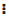

Structured data sources in Druid are organized formats from which the system can extract QnA pairs for the Knowledge Base. These sources include Excel and PDF files that adhere to specific formatting rules to ensure accurate data extraction:

## File Requirements

### Structured Excel Files

* Table Headers: The first row of your table must contain two columns with the exact headers in this order: "Questions" and "Answers."


**NOTE:** The platform accepts Excel files with table headers that include spaces (e.g., "Question" and "Answer"). It automatically trims these spaces to ensure accurate data extraction. Additionally, it supports Excel documents with multiple sheets, capturing the sheet name in the "sheetName" property for each extracted article.


* Question Length: Each question should be limited to a maximum of 625 characters. Any content exceeding this limit will be truncated during upload.

### Structured PDF Files

* Question Formatting: All questions must be in bold text and end with a question mark ("?").
* Question Length: As with Excel files, limit each question to a maximum of 625 characters to avoid truncation during upload.


**NOTE:** Uploading files that deviate from these formatting requirements may lead to inaccurate QnA extractions.


Unlike other data sources, structured data sources also allow you to manually add new QnA pairs.

## Add Data from Structured Files

To begin, follow the step-by-step instructions in [Data Source Creation](<Data Source Creation.md>). In the Add New Data Source modal, make the following settings:

1. From the **Type** drop-down, select **Structured Documents** and from the **File Type** field, choose either **Excel File (Structured)** or **PDF File (Structured)**.
2. Click **Browse** to locate your data source file on your system, select the file and click **Open**.
3. Click the **Create** button. The KB Engine starts to extract the data from the selected file.


**NOTE:**

The extraction might take a few seconds, depending on the file size. You might need to refresh the page several times until the data source status changes to "Requires training". Click the **Train** button at the top-left corner of the data source to ensure the updates are recognized by the Knowledge Base Engine.


To view the extracted QnA pairs within the data source, click on the data source.

We recommend you review the QnA pairs regularly to keep the articles relevant. You can:

* Edit the QnA pairs.
* Manually add new QnA pairs.
* Promote them to QnA flows or child intents.
* Delete outdated QnA pairs.


**IMPORTANT!** After updating QnA pairs, click the **Train** button at the top-left corner of the data source to ensure the Knowledge Base Engine recognizes the updates.



**Info:** We recommend testing the data source performance and editing existing QnA pairs to enhance it.


## Edit existing QnA pairs

You can keep your data source up-to-date by editing existing question-and-answer (QnA) pairs.

To modify a QnA pair, follow these steps:

1. Locate the QnA pair you want to edit. Click the dots () next to the desired pair and select **Edit**.
2. Make your changes. In the edit window, update the question, answer, or both fields as needed.
3. Click the **Save** button to confirm your changes.


**NOTE:** After making any modifications to your QnA pairs, it's crucial to retrain your data source. This ensures the KB Engine recognizes these updates and provides accurate responses to user queries. Click the **Train** button at the top-left corner of the data source.


## Manually add new QnA pairs

You expand your knowledge base by adding new QnA pairs directly.

To create a new QnA pair manually, follow these steps:

1. Click the **Add** button at the top right corner of your data source.
2. Enter the question and answer. In the pop-up window, type the new question in the **Question** field and the corresponding answer in the **Answer** field.
3. Click the **Save** button to finalize the creation of the new pair.


**NOTE:** Don't forget to retrain your data source after adding new QnA pairs. Retraining guarantees the KB Engine recognizes these additions and provides consistent responses to user inquiries. Click the **Train** button at the top-left corner of the data source.


## Convert QnA pairs to flows or child intents

If the AI Agent NLP model cannot match a user's intent with existing flows, it will search the Knowledge Base. If it finds a match, the AI Agent will use that QnA pair to answer the user and then enter "Idle" mode, waiting for a new intent.

To create simple business conversations, you can promote specific QnA pairs from the Knowledge Base to QnA flows. When you promote a QnA pair to a QnA flow, the flow will include one Message step with these characteristics:

* Primary Question: The question in the QnA pair becomes the primary question, the first training phrase in the flow step.
* Response Message: The answer from the QnA pair becomes the Message set in the QnA flow step.


**Info:** Add two or more similar questions when promoting a QnA pair to a QnA flow to create a comprehensive user intent for that flow.


To use a QnA pair for additional context awareness within a parent flow, transform the QnA pair into a child intent.

To promote a QnA pair to a QnA flow or child intent, follow these steps:

1. Hover the mouse over the desired QnA pair, click on the **Actions** menu (the dots) and select **Promote to QnA**. The Promote to QnA modal appears.
2. Fill out the fields described in the table below.

| Field                   | Description                                                                                                                                                                                                                                                                                                                                                                            |
| ----------------------- | -------------------------------------------------------------------------------------------------------------------------------------------------------------------------------------------------------------------------------------------------------------------------------------------------------------------------------------------------------------------------------------- |
| Name                    | The name of the QnA in the Druid AI Platform. This field is mandatory and is filled in by default with the question.                                                                                                                                                                                                                                                                   |
| Description             | A description of the QnA. This field is mandatory and localizable in the AI Agent languages. The AI Agent will use this description to help users choose the appropriate QnA if multiple QnAs match the user's question. This field is filled in by default with the question as well. **Info:** Authoring time translation is available for QnA description (if set on the AI Agent). |
| Category                | For easier filtering and efficiency, categorize your QnA. This field is mandatory.                                                                                                                                                                                                                                                                                                     |
| Response Message        | The answer to the user's question. This message is mandatory and localizable in all AI Agent languages.                                                                                                                                                                                                                                                                                |
| Subflow                 | Select this if you want to promote the QnA pair to a QnA flow and transform it into a child intent.                                                                                                                                                                                                                                                                                    |
| Parent flow             | Select the parent flow if you want to transform the QnA pair into a child intent of a specific parent flow.                                                                                                                                                                                                                                                                            |
| Training Phrases        | The primary question from the QnA pair. Add alternate questions in all AI Agent languages.                                                                                                                                                                                                                                                                                             |
| Authentication Required | Select if the QnA requires authentication (useful for AI Agents interacting with existing customers or employees).                                                                                                                                                                                                                                                                     |

3. Click **Save**. The QnA pair will be marked with a green QA label. You can edit or delete the QnA pair.

The data source requires training. Click the **Train** button at the top-left corner of the page.

## Delete QnA pairs

You can remove unwanted articles from your structured data source to maintain its accuracy and relevance.

To delete an article, hover the mouse over the desired article, click on the **Actions** menu (the dots) and select **Delete**. In the confirmation dialog, click **Yes**.

After marking an article for deletion, it will appear grayed out. This indicates it's flagged for removal but hasn't been permanently deleted yet. To undo the deletion, simply click the dots () next to the grayed-out article and select **Undo**.


**NOTE:** For your changes to take effect, you must train the data source after marking articles for deletion. Click the **Train** button at the top left corner of the data source. Once training is complete, the articles are permanently removed from the data source, and this action is irreversible.


## Compare source file with extracted articles

You can compare the original data source with the current data source by downloading them in Excel format.

To download the current data source:

1. Go to the data source.
2. Click the **Download** icon at the top left corner of the QnA Pairs page.

To download the original data source:

1. Click the **Details** tab.
2. Click the **Download** button below 'Download original file'.

Both Excel files contain two columns: Question and Answer. To compare the articles, open the two downloaded files side-by-side and compare their contents.

## Replace data source content

Druid allows you to replace all text articles from a data source in the Knowledge Base with articles from another data source.


**NOTE:** This process does not merge the articles; it completely replaces the original articles with those from the new data source.


To replace a structured data source, follow these steps:

1. In the Knowledge Base page, click on the desired structured data source.
2. Click the **Details** tab.
3. In the **Replace File** field, click **Browse**, then locate and select the new data source file.


**NOTE:** You can only replace a data source with another data source of the same type as the original.


4. Click the **Save** button to extract QnA pairs from the new data source. The new data source replaces the original one if no errors occurred.
5. Click on the **QnA Pairs** tab and click the **Train** button at the top left corner of the page to train the data source.
