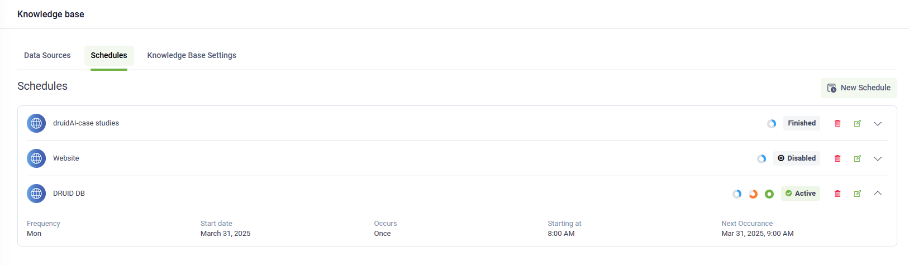
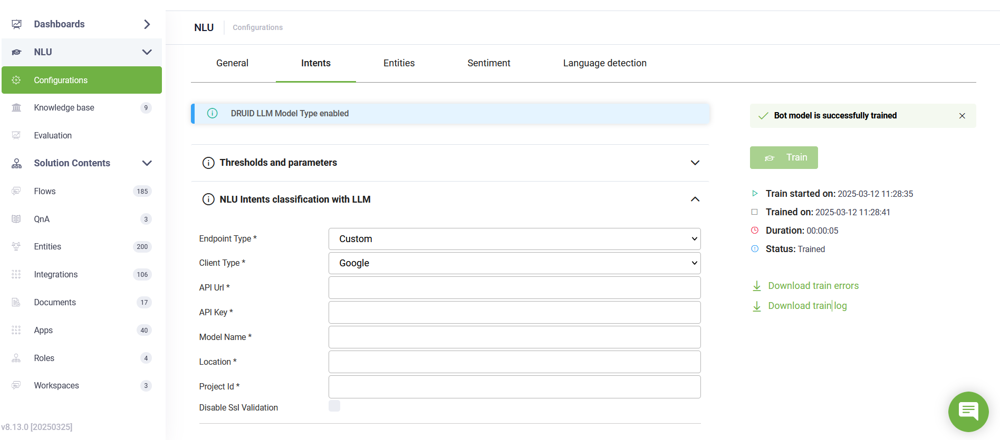

Deployment Dates

The table below lists the deployment date of DRUID v8.13 across DRUID Clouds. To view the DRUID Releases Calendar, see [Druid AI Releases](<../Druid AI Releases.md>).

| Druid Cloud Community \*.community.Druidplatform.com | Druid Cloud US \*.us.Druidplatform.com | Druid Cloud Australia \*au.Druidplatform.com | Druid Cloud West-Europe (PROD) \*.Druidplatform.com |
| ---------------------------------------------------- | -------------------------------------- | -------------------------------------------- | --------------------------------------------------- |
| March 26, 2025                                       | April 04, 2025                         | April 10, 2025                               | April 10, 2025                                      |

These release notes give you a brief, high-level description of the improvements implemented to existing features.

If you have questions about your DRUID tenant, please contact [support@Druidai.com](mailto:support@druidai.com) or your local DRUID partner for more information.

**Recommended!** This release includes features that require upgrade of your DRUID Connector Host:

* Connector - New Druid APIs with Built-in Authentication
* REST Connector - JWT Assertion Authentication with Microsoft Identity Platform
* Connector Integration Tasks – improved Test experience

## What's New

* **Knowledge Base Schedule - technology preview**. We're excited to introduce the Knowledge Base (KB) Schedule, a new feature that enables authors to automate crawling, extraction, and training for unstructured data sources. With scheduled updates, your knowledge base remains accurate and up-to-date with minimal manual effort.


**NOTE:** The KB Schedule is a tenant feature. If you want activate it on your tenant, reach out to [DRUID Support](../../13_Release%20Notes/Previous%20Releases/mailto:support@druidai.com).


For more information, see [Knowledge Base Schedule](https://druidai.gitbook.io/druid-ai-docs/knowledge-base/data-management-and-schedules/knowledge-base-schedule).

* **Flow Engine - UpdateIntentMatching internal action**. We're excited to introduce the **UpdateIntentMatching** internal action, a powerful enhancement for refining intent matching outcomes within your Knowledge Base. Primarily utilized in the KB Response Flow, this action ensures the Evaluation Tool accurately reflects whether a relevant intent was ultimately identified, particularly in situations where a Large Language Model (LLM) provides the final answer following an initial 'Intent Not Found' classification.

This new action offers several key benefits:

* Facilitates manual corrections and feedback loops to refine intent recognition.
* Reduces false negatives by correctly recording when a response is provided, even after an initial "intent not found".
* Optimizes the handling of GPT-generated responses, particularly in "Intent Not Found" scenarios.
* Facilitates Knowledge Base refinement. Logs the source of KB articles, aiding in the evaluation and improvement of KB content.

For more information, see [Internal Actions](https://druidai.gitbook.io/druid-ai-docs/ai-platform/build-ai-agents/authoring-tools/flows/conversational-flows/internal-actions).

* **KB - Enhanced search with new rerankers**. We’ve added two new rerankers to help improve the accuracy and relevance of search results in your Knowledge Base:
* **HigherEducation** – Optimized for content related to universities and higher education.
* **LLM Reranker** – Uses large language models (LLMs) to deliver more semantically relevant results.

You can configure these rerankers in KB Advanced Settings to fine-tune how your AI Agent retrieves and ranks information. For more information, see [Score Calculator](https://druidai.gitbook.io/druid-ai-docs/knowledge-base/kb-settings/kb-advanced-settings/score-calculator).

* **Flow Engine - Configure prediction destination (KB or NLP) at the conversation level**. You can now control where intent prediction occurs within a conversation using the new **\[\[ChatUser]].PredictDestination** parameter. This allows you to define whether predictions should be processed using the Knowledge Base (KB), Natural Language Processing (NLP), or a combination of both.

The system retains the selected prediction method until it is explicitly changed. Using this parameter optimizes the execution pipeline, eliminating the need for separate intent-matching actions. For more information, see [System Entities](https://druidai.gitbook.io/druid-ai-docs/ai-platform/build-ai-agents/authoring-tools/ai-agent-informational-model/system-entities).

* **Enhanced NLU and KB with new embedding models**. We've expanded the capabilities of NLU Classification and Knowledge Base search with the introduction of two new embedding models, now available in KB basic settings and the NLU.NER.Classification.ModelEmbeddings parameter:
* **HigherEducation.v1** (English): This specialized model is trained on a rich dataset of higher education content, including university-specific information, leading to improved accuracy when dealing with queries related to this domain.
* **MultiAspect**: An enhanced version of our existing Multilingual model, MultiAspect offers improved performance across multiple languages and incorporates score correction for more accurate results.

These new embedding models provide more options to optimize your AI Agent's understanding and retrieval of information, catering to specific content domains and multilingual scenarios.

* **AudioCodes Channel – Real-time response recommendations with Agent Assist**. This release introduces a significant enhancement to Agent Assist: real-time response recommendations. Leveraging AI, Agent Assist now analyzes customer inquiries and proactively suggests relevant and accurate responses to helpdesk agents. This new capability empowers agents to handle interactions more efficiently, reduce response times, and improve overall customer satisfaction. For more information, see [Voice Audio Codes Channel](https://druidai.gitbook.io/druid-ai-docs/channels/voice-and-telephony/voice-audio-codes-channel).
* **Connector - New Druid APIs with Built-in Authentication**. This release introduces a set of new Druid APIs with built-in authentication, providing you with the ability to perform specific actions directly within your integrations. Previously, these operations were primarily limited to the Druid Portal UI or usage within the flows. This enhancement, driven by feedback from our internal delivery consultants who value efficient integration workflows, simplifies how you interact with these key Druid functionalities.
* `/api/services/app/Flow/GetQnAPaged`
* `/api/services/app/Flow/GetFlowsPaged`
* `/api/services/app/KnowledgeBase/MarkDataSourceForTrain`
* `/api/services/app/Solution/ExportSolutionAsync`
* `/api/services/app/Solution/GetSolutionForEditAsync`
* `/api/services/app/Solution/DownloadSolutionBinaryObject`
* `/api/services/app/Flow/CreateOrUpdateFlow`
* `/api/services/app/FlowStep/CreateOrUpdateFlowStep`
* `/api/services/app/KnowledgeBase/CreateDataSource`
* `/api/services/app/KnowledgeBase/ExtractDocumentContent`
* `/api/services/app/KnowledgeBase/ExtractDocumentContentFromUrl`
* `/api/services/app/KnowledgeBase/GetDataSource`
* `/api/services/app/KnowledgeBase/SearchKbGraph`

## Improvements

* **REST Connector - JWT Assertion Authentication with Microsoft Identity Platform**. This release introduces JWT Assertion Authentication, providing a robust and secure method for authenticating API calls. This new feature allows you to leverage JSON Web Tokens (JWTs) signed with a certificate owned by your application and issued by the Microsoft Identity Platform. Ideal for integrations with APIs requiring this authentication method, you can now configure DRUID apps with the 'MicrosoftIdentityPlatform' security type, streamlining the process and enhancing security. For more information, see [JWT Assertion Authentication](https://druidai.gitbook.io/druid-ai-docs/ai-platform/integrations/enterprise-connectors/rest/rest-apps/jwt-assertion-authentication).
* **Live Chat – Reply to Previous Messages**. We've introduced a new parameter, **replyToMessageEnabled** (**Send Box** > **Layout**), in the web chat snippet customization. When enabled, helpdesk agents can reply to any of the user messages within the Active Conversation section, improving the live chat experience.

* **VoiceText channel - Timeout parameter**. This release introduces a new parameter, **Timeout** for the VoiceText channel's **Send Message** request. You can now specify a duration in seconds for the system to wait for a response from the Flow Engine. If the Flow Engine doesn't respond within the configured timeout period, the system will log an error in the Conversation History: "_\[Channel connection timed out] The voice channel connection timeout was reached. The previous AI Agent message may have also been dropped before reaching the client's conversation_".

This enhancement provides better control and visibility over potential connection issues with the VoiceText channel.

* **LookupEntity internal action - MaxLimitForOutput**. The LookupEntity Internal Action now includes the MaxLimitForOutput parameter, providing you with enhanced control over the number of entities returned by the machine learning (ML) model. You can now define the maximum number of entities the model will output, allowing you to tailor the result set size to your specific needs. By default, this value is set to 10. For more information, see [Internal Actions](https://druidai.gitbook.io/druid-ai-docs/ai-platform/build-ai-agents/authoring-tools/flows/conversational-flows/internal-actions).
* **\[\[ChatUser]].AvailableLanguages improvement**. In this release, \[\[ChatUser]].AvailableLanguages now includes additional languages defined through the conversation time machine translation feature. Previously, only the AI Agent languages were considered. With this update, any additional languages you define for machine translation will also be included, ensuring proper use in the Language Changed flow for accurate language detection.
* **Connector Integration Tasks – improved Test experience**. The **Test** tab now automatically prefills the BotId, allowing you to seamlessly test an integration task without manually searching for and entering the BotId when required.

* **Voice Messages – Separate STT from TTS**. Voice message support has been enhanced for WhatsApp, WhatsApp Meta, RingCentral, and Cuedesk. Now, you can control whether the AI Agent responds with text or voice messages, providing greater flexibility in voice interactions..

When **Support voice messages** is enabled, the AI Agent replies with text by default. To have the AI Agent respond with voice, toggle on **Reply with voice messages**.

* **Website Data Sources – Enhanced crawling logs**. The logs now include the parameters used when crawling document content from websites. This improvement provides greater transparency and debugging capabilities, making it easier to track, troubleshoot, and optimize the crawling process.

* **Knowledge Base – Default image extraction**. Image extraction is now enabled by default for Standard extractors (DOC and DOCX files) and Elpis extractors (PDF files). The setting "LinkAndPersistFileResourcesOnExtract" is now set to **true** by default in KB Advanced Settings JSON and under `featureFlags` in the JSON configuration.

* **NLU Intents Classification with Google Vertex AI (Technology Preview)**. You can now configure NLU Intents Classification using Google Vertex AI, enabling advanced intent recognition and classification.

* **Alert Flows – UI Enhancements**. The Alert Flows UI has been improved to provide a more seamless and intuitive experience for authors. For more details, see [Alert Flows](https://druidai.gitbook.io/druid-ai-docs/ai-platform/build-ai-agents/authoring-tools/flows/alert-flows).

.png>)

* **KB Advanced Settings - Enhanced Generative Endpoint Configuration**. This release introduces a more flexible way to manage generative endpoints within KB Advanced Settings. You can now specify whether to utilize DRUID's dedicated resources for Large Language Models (LLMs) or configure custom endpoints to suit your specific needs. This change provides greater control over your generative AI integrations while maintaining backward compatibility.


**NOTE:** To ensure clarity, all generative endpoints created prior to DRUID version 8.13 have been labeled as "Obsolete." Rest assured, these older endpoints remain fully functional and will continue to operate as configured in your existing setups


For more information, see [Generative Endpoints](https://druidai.gitbook.io/druid-ai-docs/knowledge-base/kb-settings/kb-advanced-settings/generative-endpoints).
