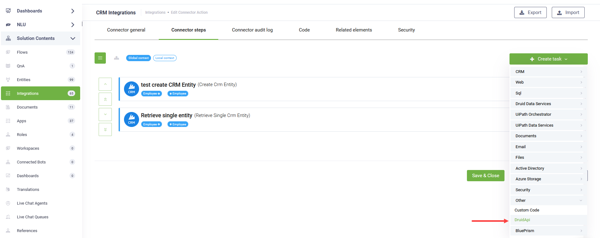
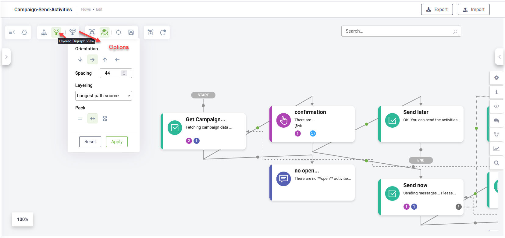

Deployment Dates

The table below lists the deployment date of DRUID v8.14 across DRUID Clouds. To view the DRUID Releases Calendar, see [Druid AI Releases](<../Druid AI Releases.md>).

| Druid Cloud Community \*.community.Druidplatform.com | Druid Cloud US \*.us.Druidplatform.com | Druid Cloud Australia \*au.Druidplatform.com | Druid Cloud West-Europe (PROD) \*.Druidplatform.com |
| ---------------------------------------------------- | -------------------------------------- | -------------------------------------------- | --------------------------------------------------- |
| April 10, 2025                                       | May 8, 2025                            | May 8, 2025                                  | May 8, 2025                                         |

These release notes give you a brief, high-level description of the improvements implemented to existing features.

If you have questions about your DRUID tenant, please contact [support@Druidai.com](mailto:support@druidai.com) or your local DRUID partner for more information.

**Recommended!** This release includes features that require upgrade of your DRUID Connector Host:

* Connector - New Druid APIs with Built-in Authentication
* DRUID Data Service Connector – Batch processing enhancement for Add Entity integration

## What's New

* **Flow Details - Commands section for technical utterances**. With this release, a new **Commands** section is available in flow details, allowing you to define technical utterances as exact-match commands. These are training phrases that are not used to train the NLP model. Instead, they are matched exactly and are ideal for handling structured or technical inputs; for example: **\_\_update\_db\_parameters\_\_** or **#CreateNewFlowFromBot**. This approach helps reduce noise in language understanding, especially when using NLP models with LLM support.


**NOTE:** If you have technical flows that currently include such phrases in their NLP training data, make sure to update those flows. Remove the technical phrases from the training phrases section and add them to the new Commands section instead.


* **Sprinklr channel**. With this release, you can integrate AI Agents with Sprinklr to handle user requests within the chosen channels in Sprinklr flows. For information on how to configure the channel, see [Sprinklr](https://druidai.gitbook.io/druid-ai-docs/channels/engagement-and-support/sprinklr-integration).

## Improvements

* **Druid Conductor - Trigger flows between orchestrated AI Agents or from an orchestrated AI Agent to the Druid Conductor**. With this release, you can now trigger a flow from one orchestrated AI Agent to another orchestrated AI Agent or from an orchestarted AI Agent to the Druid Conductor itself.


**NOTE:** Cross-child flow triggering is only supported within the Druid Conductor conversation. It is not available when interacting directly with an individual child AI Agent.



**NOTE:**

* If a child AI Agent is removed from the Druid Conductor, any flows that rely on it will no longer trigger.
* If a AI Agent is assigned as a child to multiple megabots, the flow list will display flows from all child AI Agents across those megabots—grouped by AI Agent. Make sure to select the correct flow to avoid misrouting or triggering unintended behavior.


* **Connector - New Druid APIs with Built-in Authentication**. This introduces new Druid APIs with built-in authentication, providing you with the ability to perform specific actions directly within your integrations:
* `api/services/app/AI Agent/GetBotForEditChannelsAsync` - Retrieves channel configuration details for a specific AI Agent, including VoiceText endpoint information. Useful for integrations that require dynamic access to channel settings, such as in the KB Toolkit.
* `api/services/app/Bot/GetBotForEditAsync` - Returns editable configuration data for a specific AI Agent. This includes flow settings like the Intent Not Recognized flow and KB Search Flow, which are essential for managing fallback behavior in integrations used in the KB Toolkit.
* `api/services/app/KnowledgeBase/GetCollection` - Fetches information about the knowledge base collections linked to a AI Agent. This is helpful when determining the flow configurations associated with the Intent Not Recognized flow, or KB Search Flow.
* `api/services/app/User/GetUsers` - Retrieves a list of users in the current environment. This is typically useful when creating custom views in workspaces.

.png>)

* **Extended language support in chat snippet**. Additional languages defined through the conversation time machine translation feature are now also available for use in the chat snippet.

* **DRUID Data Service Connector – Batch processing enhancement for Add Entity integration**. This release introduces a new option for the Add Entity integration, **Set parent reference for Batch**. When adding multiple child records in a batch, this option automatically links each child to its parent entity—no need for manual foreign key mapping via Custom Code integration.


**NOTE:** To use this feature, you must first define a proper relationship between the parent and child entities by configuring a foreign key field in the child entity that references the parent.


For more information, see [Add Entity](https://druidai.gitbook.io/druid-ai-docs/integrations/enterprise-connectors/druid_data_-service_connector/add_entity).

* **Knowledge Base – Improved Word Extractor**. The Word Extractor now captures hyperlinks embedded in portions of text, making it easier to extract linked URLs along with the associated content.

* **Flow Diagram – Layered Digraph View**. You can now visualize flows using the new Layered Digraph View in the Flow Diagram. This view provides a structured, hierarchical layout for easier understanding of flow sequences. Multiple view options are available to suit your preferences.

* **Custom Dashboards – Support for AI Agent KPIs**. You can now configure widgets in custom dashboards to display AI Agent KPIs. This allows you to track and visualize AI Agent performance metrics directly within your personalized dashboard. For more information, see [Custom Dashboards](https://druidai.gitbook.io/druid-ai-docs/data-analytics-and-insights/track-business-kpis).
