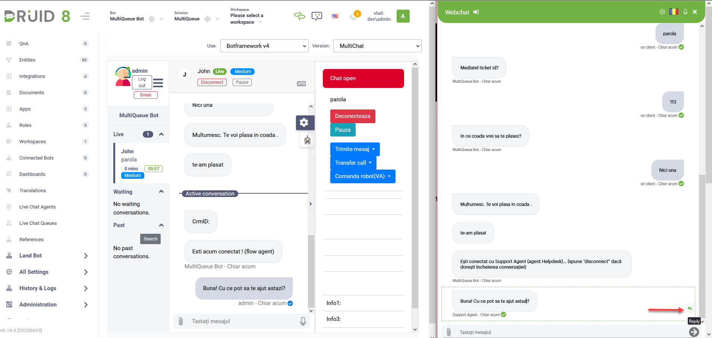

Deployment Dates

The table below lists the deployment date of DRUID v8.18 across DRUID Clouds. To view the DRUID Releases Calendar, see [Druid AI Releases](<../Druid AI Releases.md>).

| Druid Cloud Community \*.community.Druidplatform.com | Druid Cloud US \*.us.Druidplatform.com | Druid Cloud Australia \*au.Druidplatform.com | Druid Cloud West-Europe (PROD) \*.Druidplatform.com |
| ---------------------------------------------------- | -------------------------------------- | -------------------------------------------- | --------------------------------------------------- |
| June 5, 2025                                         | July 3, 2025                           | July 3, 2025                                 | July 3, 2025                                        |

These release notes give you a brief, high-level description of the improvements implemented to existing features.

If you have questions about your DRUID tenant, please contact [support@Druidai.com](mailto:support@druidai.com) or your local DRUID partner for more information.

**Recommended!** This release includes features that require upgrade of your DRUID Connector Host:

* Authenticate Action - Text response mapping
* DRUID Data Service Connector: Delete Entity - Cascade Delete
* DRUID Services Connector - variable name in the Base URL
* REST Connector fix

## What's New

* **Agent Flow for Advanced AI Capabilities (Technology Preview)**. We are excited to introduce the new Agent step, bringing advanced AI agent capabilities directly into your conversational flows. This powerful step leverages an agentic framework, enabling your AI Agent to reason, plan, and execute complex tasks by breaking down goals into manageable steps. AI Agents can now dynamically decide actions, converse with users to gather information, and utilize various tools (functions) to achieve objectives, making your AI Agents more adaptable and capable of handling complex, multi-turn interactions. This feature is ideal for scenarios requiring dynamic decision-making, complex information gathering, and seamless integration with external tools and APIs.

For more information, see [Agent Step](https://druidai.gitbook.io/druid-ai-docs/ai-platform/build-ai-agents/authoring-tools/flows/conversational-flows/flow-steps/agent-step).

* **VoiceText Channel - Enhanced responsiveness with Long Polling**. We're excited to announce the introduction of Long Polling for the VoiceText channel, significantly improving responsiveness and user experience in Contact Center voice integrations. While the VoiceText channel traditionally uses a synchronous request-response model, which is ideal for simpler conversations, it can sometimes introduce delays during complex interactions involving integrations or Proactive AI Agent messages. The new asynchronous long polling mechanism addresses this by allowing your Contact Center to receive AI Agent responses as soon as they're available, ensuring a more fluid and efficient conversation flow.

For more information, see [VoiceText channel](https://druidai.gitbook.io/druid-ai-docs/channels/voice-and-telephony/voice_text_integration).

* **DRUID Data Service Connector: Delete Entity - Cascade Delete**. We are pleased to announce the addition of Cascade Delete functionality within the Delete Entity integration tasks. This new feature allows you to automatically propagate delete operations to related child records (entity lists), ensuring data consistency and preventing orphaned data. When configuring a Delete Entity task, you can now select specific entity lists where the delete action should also be applied, streamlining data management and improving data integrity.

For more information, see [Delete Entity](https://druidai.gitbook.io/druid-ai-docs/ai-platform/integrations/enterprise-connectors/druid_data_-service_connector/delete_entity).

* **Knowledge Base - Website data sources - Subdomain Crawling Support**. Website data sources now support crawling web pages from subdomains of the provided URL. This improvement removes the need to create separate data sources for each subdomain, streamlining setup and maintenance. You can enable subdomain crawling during data source creation or later from the data source details.

## Improvements

* **Authenticate Action - Text response mapping**. The Authenticate action now supports mapping tokens returned as a simple string in the response body. If your authentication client returns the token directly as a string (e.g., "yourTokenString123") rather than within a JSON object, you can now map this response directly. When configuring the Authenticate action's response mapping, simply leave the Connector field name column empty to correctly capture the plain text token.

* **DRUID Services Connector - variable name in the Base URL**. You can now use URL variables (for example, @\_Druid.LLM\_URL) directly in the **Base URL** field of the app, making integration setup easier and more dynamic.

For more information, see [DRUID Services](https://druidai.gitbook.io/druid-ai-docs/ai-platform/integrations/enterprise-connectors/druidservices).

* **Live Chat – Reply to Previous Messages**. We’ve improved the user experience and UI when replying to previous messages in Live Chat. These updates make it easier to follow conversations and provide more context when responding to users.

* **Flows – Mark flows as special flows**. You can now mark flows as special flows from the Flow details panel by selecting a **Special flow type**. This enhancement improves the authoring experience by making it easier to identify and select the correct special flow in the Dialogue Management section of the AI Agent.

.png>)

* **Knowledge Base - Default Chunker**. The default generative endpoint is now DRUID LLM, model Becus 1.0.

* **Web Forms – Icon support for fields**. You can now add a small icon next to a field name or its value in web forms. Choose from a predefined set of icons and customize their color to enhance visual clarity and user experience.

* **Administration - Druid Services improvement**. Expired tokens are now hidden by default in **Administration** > **Druid Services**, making it easier to view active tokens. To see the full list, including expired tokens, toggle on **Show inactive tokens**.

## Bug Fixes

* **Telegram channel – inconsistent button display**. Fixed an issue where buttons from hero cards and choice prompts in the Telegram channel appeared differently and truncated text. All buttons now have a consistent appearance and support vertical display with up to two lines of text, improving readability and user experience.
* **REST Connector fix**. The REST Connector now correctly processes and maps emoji characters received in REST API responses, preventing previous display or parsing issues.
* **Views - Relations tab fix**. Fixed an issue where self-referencing entity fields in the **Relations** tab of the Views editor could be expanded infinitely. Fields now expand only as defined by the relationship configuration.
* **Web views fix**. Fixed an issue where filters based on boolean fields did not work correctly in web views. Boolean filters now apply as expected.
