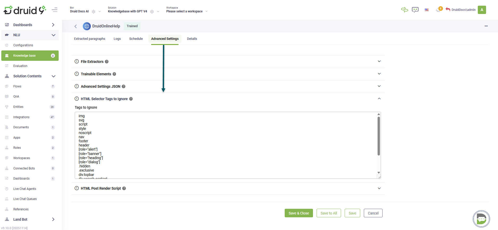

Deployment Dates

The table below lists the deployment date of DRUID v9.10 across DRUID Clouds. To view the DRUID Releases Calendar, see [Druid Releases](<../Druid AI Releases.md>).

| Druid Cloud Community \*.community.Druidplatform.com | Druid Cloud US \*.us.Druidplatform.com | Druid Cloud Australia \*au.Druidplatform.com | Druid Cloud West-Europe (PROD) \*.Druidplatform.com |
| ---------------------------------------------------- | -------------------------------------- | -------------------------------------------- | --------------------------------------------------- |
| November 20, 2025                                    | December 18, 2025                      | December 18, 2025                            | December 18, 2025                                   |

These release notes give you a brief, high-level description of the improvements implemented to existing features.

If you have questions about your DRUID tenant, please contact [support@Druidai.com](mailto:support@druidai.com) or your local DRUID partner for more information.

**Recommended!** This release includes features that require upgrade of your DRUID Connector Host:

* Druid Data Service – New DATETIME Functions for Custom Queries

## What's New

* **External Webhook Calls — Async Execution for Long-Running Operations**. You can now run long-running jobs through asynchronous integrations. This is useful for tasks such as bulk SMS operations or sequential API calls that take more than five minutes to complete. Async execution prevents webhook timeouts and keeps processing reliable. The following two items are new:
* **asyncResponse** parameter in the **/GenericIntegration** endpoint. When **asyncResponse=true**, the call starts an async job and immediately returns an **invocationId** so your system doesn’t wait for completion.
* New **/GetGenericIntegrationResponse** endpoint. Lets you poll for job status and retrieve the final response once processing is complete.

Async mode uses the same request structure as synchronous calls, making it simple to adopt. This update improves integrations with external systems that need extended processing time, without requiring retries or workarounds.

For more information, see [External Webhook Call Handling in Druid](https://druidai.gitbook.io/druid-ai-docs/integrations/webhooks/exchanging-data-with-external-systems).

## Improvements

* **Druid Data Service – New DATETIME Functions for Custom Queries**. Two new date functions are now available when filtering data with custom queries in Druid Data Service:
* **GETDATE()** – Returns the current UTC date and time.
* **TODAY()** – Returns the current UTC date with the time set to midnight.

These functions help you create more accurate and consistent time-based filters in your custom queries. For more information, see [Filter Data Using DRUID Custom Query](https://druidai.gitbook.io/druid-ai-docs/integrations/enterprise-connectors/druid_data_-service_connector/filter-using-druid-custom-query).

* **KB – Website data sources – Flexible control of 'HTML Selector Tags to Ignore'**. You can now set **HTML Selector Tags to Ignore** directly at the data source, node, and leaf levels. This update gives you more flexibility to fine-tune extraction rules for each website data source, so you can exclude unwanted HTML elements without relying on global KB settings.

## Bug Fixes

* **Telegram channel – Fixed formatting issues with multiple new lines**. Messages containing multiple new lines now render correctly in Telegram chats, preserving both spacing and Markdown formatting.
