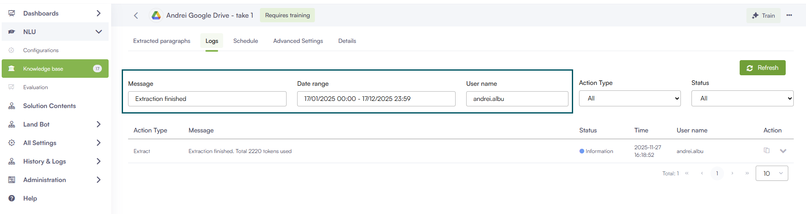

Deployment Dates

The table below lists the deployment date of DRUID v9.12 across DRUID Clouds. To view the DRUID Releases Calendar, see [Druid Releases](<../Druid AI Releases.md>).

| Druid Cloud Community \*.community.Druidplatform.com | Druid Cloud US \*.us.Druidplatform.com | Druid Cloud Australia \*au.Druidplatform.com | Druid Cloud West-Europe (PROD) \*.Druidplatform.com |
| ---------------------------------------------------- | -------------------------------------- | -------------------------------------------- | --------------------------------------------------- |
| December 18, 2025                                    | February 12, 2026                      | February 12, 2026                            | February 12, 2026                                   |

These release notes give you a brief, high-level description of the improvements implemented to existing features.

If you have questions about your Druid tenant, please contact [support@Druidai.com](mailto:support@druidai.com) or your local Druid partner for more information.

**Recommended!** This release includes features and bug fixes that require upgrade of your Druid Data Service:

* Data Service - Web Form Image Field Preview

## What's New

* **Google - Portal SSO login**. This release introduces Google Portal SSO login support to simplify your authentication workflow. By allowing team members to access the Druid Portal with their Google credentials, this feature reduces the need for credential management and makes portal access faster and more secure. For more information, see [Provisioning Portal Users with Google](https://druidai.gitbook.io/druid-ai-docs/ai-platform/ai-governance-and-security/data-security-and-privacy/authoring-user-management/provisioning-portal-users-with-google).

## Improvements

* **Amazon Live Chat - Real-Time Queue Position Retrieval**. You can now enable the retrieval of a user's real-time position in the Amazon Connect Live Chat queue and include it in the Druid conversation context. To activate this, set the **PositionInQueueSetByCC** parameter to true in the **ConnectToHelpdeskAgent** internal action. For more information, see [Enable real-time queue position retrieval from Amazon Connect](https://druidai.gitbook.io/druid-ai-docs/contact-centers/amazon-live-chat#Enable).


**NOTE:** This feature requires granting the AWS user an IAM policy with **GetContactMetrics** permissions.


* **Outlook Channel- Email Attachment Antimalware Scan**. Enhanced security for the Outlook channel by introducing an email attachment antimalware scan. If an incoming email contains a malicious file, the Flow Engine continues the conversation using only the safe components (such as the email body and recipients). Details regarding the infected email and the malicious file names are logged in the Conversation History.
* **Knowledge Base - improvements**. This release introduces various improvements to the KB:
* **More options in Trainable elements for Content chunker with LLM**. DRUID introduces extended configuration options for the LLM content chunker, providing greater control over how document data is summarized, tagged, and used for training. These features enable higher prediction accuracy and more robust evaluation datasets. For more information, see [Content Chunkers](https://druidai.gitbook.io/druid-ai-docs/knowledge-base/kb-settings/kb-advanced-settings/content-chunkers#Extended) and [Trainable Elements](https://docs.druidai.com/docs/Content/Knowledgebase/Trainable%20Elements.htm).

**NOTE:** While these options ensure higher quality matching at prediction time, they may increase chunking execution time.

* **Extract content from EML documents**. When extracting data from EML documents—using either the **KBExtractDocumentContent** internal action or the **ExtractDocumentContent** API—the full email content is saved in the **answer** and **content** fields. In addition, the response JSON now includes the following email metadata fields: **To**, **From**, **Subject**, and **Date**, making the extracted data easier to process and use in business applications. For more information, see [KBExtractDocumentContent](https://druidai.gitbook.io/druid-ai-docs/ai-platform/build-ai-agents/authoring-tools/flows/conversational-flows/internal-actions#KBExtrac) or [KB Extraction Tools](https://druidai.gitbook.io/druid-ai-docs/knowledge-base/advanced-features-and-optimization/kbextractiontools).

```
{
  "to": "recipient@example.com",
  "from": "sender@example.com",
  "subject": "Email subject line",
  "date": "2024-01-15T10:30:00Z",
  "paragraphs": [
    {
      "question": "string",
      "answer": "Complete email body content including To: recipient@example.com, From: sender@example.com, Subject: Email subject line, Date: 2024-01-15T10:30:00Z, and the full message body text",
      "content": "Complete email body content including To: recipient@example.com, From: sender@example.com, Subject: Email subject line, Date: 2024-01-15T10:30:00Z, and the full message body text"
    }
  ],
  "error": "string"
}
```

* **Enhanced Log Filtering for Unstructured Data Sources**. This release adds improved filtering options for logs from unstructured data sources:
* **Date range**: Filter logs by a specific time period.
* **User name**: Search by full or partial user names.
* **Message**: The previous 'Filter' field has been renamed to 'Message' for clarity.



These enhancements make it easier to find and analyze extraction and processing logs.

* **Data Service - Web Form Image Field Preview**. You can now set the default row span for the file preview component within image fields. This provides greater control over the form layout, ensuring a better out-of-the-box display for images.


* **Druid Vision – New Romanian Identity Card improvements**. This release introduces several improvements for handling Romanian identity documents (New\_IdentityCard endpoint):
* You can now upload two separate PDF files, each containing one side of the identity card. Previously, a single PDF with both sides was required.
* The endpoint now supports OCR processing of the official address certificate issued by the national authority responsible for population records and identity documents.


**NOTE:** Only original electronic documents downloaded from the Romanian Police Department are accepted. Scans or photos of the document are not allowed.


## Bug Fixes

* **Fixed time entity extraction offset issue**. Fixed an issue where the Flow Engine returned time entity values with an incorrect +2-hour offset. The time extraction logic now correctly preserves the user-specified time without unintended time zone conversions.
* **Evaluation - Export Conversation History**. Fixed an issue where conversation history reports were exported using UTC time. The report generation logic now ensures that all timestamps in the downloaded Excel file are correctly aligned with the tenant time zone.
* **KB threshold score visualization**. Fixed an issue where KB search results failed to respect defined threshold limits. Matches with a confidence score below the KB minimum threshold are now correctly identified and displayed in red within the interface.
