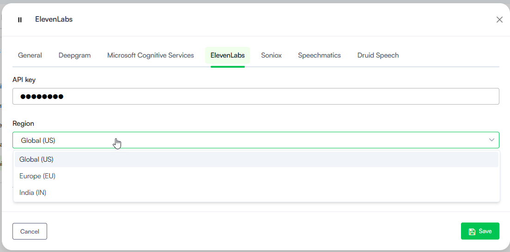

Deployment Dates

The table below lists the deployment date of Druid v9.23 across Druid Clouds. To view the Druid Releases Calendar, see [Druid Releases](<../Druid AI Releases.md>).

| Druid Cloud Community \*.community.Druidplatform.com | Druid Cloud US \*.us.Druidplatform.com | Druid Cloud Australia \*au.Druidplatform.com | Druid Cloud West-Europe (PROD) \*.Druidplatform.com |
| ---------------------------------------------------- | -------------------------------------- | -------------------------------------------- | --------------------------------------------------- |
| May 21, 2026                                         | June 04, 2026                          | June 04, 2026                                | June 04, 2026                                       |

These release notes give you a brief, high-level description of the improvements implemented to existing features.

If you have questions about your Druid tenant, please contact [support@Druidai.com](mailto:support@druidai.com) or your local Druid partner for more information.

## What's New

* **AI Authoring Agents – Entity Model and Druid Data Service Orchestration**. AI Authoring Agents now enable authors to quickly build agentic skills within their AI Agents. They automatically create the complete skill package: the conversational flows, entity data models, and orchestrated Druid Data Service integrations. The result is a fully configured, functional agentic skill that enables the AI Agent to both interact naturally with users and operate autonomously to achieve outcomes based on user intent — eliminating the need for additional manual configuration.

Previously, authors had to manually define informational models and configure Druid Data Service integrations after the initial agentic skill creation. With this release, AI Authoring Agents automate the entire pipeline, generating complete and functional agentic skills out of the box.

For more information, see [AI Authoring Agents](https://druidai.gitbook.io/druid-ai-docs/build-ai-agents/ai-authoring-agents).

* **Druid External Live Chat**. The Druid External Live Chat is a unified contact center that enables support teams to efficiently manage and respond to client interactions across multiple AI Agents from a single interface. For more information, see [Druid External Live Chat](https://druidai.gitbook.io/druid-ai-docs/contact-centers/druid-external-live-chat).

**Key benefits**

* **Centralized support operations**. Manage conversations from multiple AI Agents in a single helpdesk AI Agent. Helpdesk agents no longer need to switch between multiple live chat systems.
* **Advanced routing capabilities**. Route conversations to dedicated queues based on metadata or queue codes received from client AI Agents.
* **Separation of operational and business logic**. Keep business-specific operations inside client AI Agents while using a dedicated helpdesk AI Agent exclusively for live chat operations.

**Typical use cases**

* Shared support centers serving several business units or customer segments
* Multi-tenant deployments
* Organizations that need centralized live chat governance and reporting.
* **Google SAML SSO Authentication for Portal Users**. We are excited to introduce support for Google Single Sign-On (SSO) authentication via the SAML protocol. Driven by client feedback to better support enterprise user management, this feature allows your team members to securely log into the portal using their managed Google Account credentials. For more information, see [Provisioning Portal Users with Google SAML](https://druidai.gitbook.io/druid-ai-docs/ai-governance-and-security/data-security-and-privacy/authoring-user-management/provisioning-portal-users-with-google-saml).

**Key Benefits**

* **Simplified Access Management**. Team members use a single set of familiar corporate credentials, removing login friction.
* **Enhanced Security Controls**. Leverage your enterprise Google Workspace authentication policy, including multi-factor authentication (MFA) and conditional access rules.
* **Reduced Administrative Overhead**. Decrease IT support tickets by eliminating separate portal password resets and account lockouts.
* **Accelerated Onboarding**. New team members gain immediate Druid Portal access the moment their corporate Google account is provisioned.
* **AI Engagement Analyst** (formerly Conversation Toolkit 2). Every conversation your business has is a goldmine of insight — and most of it goes untapped. Meet **AI Engagement Analyst**, the smart way to understand what your customers truly experience. Powered by AI, it automatically analyzes chat and voice interactions at scale, extracting structured metrics like Sentiment, Friction, Clarity, and Outcome — in real time and historically — across both AI-powered and live customer support channels.

Purpose-built dashboards and an expanded set of charts make trends impossible to miss and decisions easier to justify, giving contact center teams and business leaders instant visibility into what's working, what's frustrating customers, and how agents are truly performing. No manual reviews. No sampling. No blind spots. Just continuous, effortless conversation intelligence that helps you act faster, improve performance, and deliver better customer experiences — at any scale.

For more information, see [AI Engagement Analyst](https://druidai.gitbook.io/druid-ai-docs/solution-library/business-apps/agentic-solutions/ai-engagement-analyst).

* **Governance & Security - Passkey Login Support**. This release introduces passkey login support, allowing administrators to enable a more secure, biometric, or hardware-based authentication method for Druid Portal users.
* **Admin Control**. Administrators can easily activate this feature on the tenant.
* **Streamlined User Experience**. Once enabled by the tenant administrator, portal users can link a passkey manager directly from their user account.
* **Passwordless Authentication**. After a quick setup, users can bypass standard password entry and log into the Druid Portal seamlessly using their device PIN, biometric data, or passkey manager authentication.

For more information, see [Passkey Login Configuration](https://druidai.gitbook.io/druid-ai-docs/ai-governance-and-security/data-security-and-privacy/authoring-user-management/passkey-login-configuration).

## Improvements

* **AudioCodes Channel - Voicemail Detection Support for Outbound Calls**. We have enhanced the AudioCodes channel to support voicemail detection for outbound AudioCodes Live Hub call campaigns.

Previously, in automated outbound calls, the AI Agent could start speaking over a voicemail greeting, resulting in cut-off messages and missed connections. With this update, the AI Agent can detect an answering machine, wait for the voicemail greeting to finish, and deliver a perfectly timed message after the tone. For more information, see [Voice AudioCodes](https://druidai.gitbook.io/druid-ai-docs/channels/voice-and-telephony/voice-audio-codes-channel#Handling).

* **Google Chat Channel- Improved HTML message rendering**. Messages sent in HTML format, including images and formatted content, are now rendered similarly to the Direct Line channel instead of displaying raw HTML code.
* **Web Chat Voice Channel – Added support for multiple ElevenLabs API residency endpoints**. You can now configure Global (US), Europe (EU), or India (IN) regions for ElevenLabs speech services directly from the channel configuration UI. The selected region determines which ElevenLabs API endpoint is used by the Web Chat Voice channel.

* **Hero Card repeaters — nested entity fields**. Hero Cards with **Is Repeater** enabled now support nested field paths on entity-type fields (for example, \[\[Case]].Status.Name) directly within repeater elements.

Previously, repeaters could only bind to scalar fields on the root entity (for example, \[\[Case]]). Displaying a value like Status.Name — where Status is itself an entity-type field — required a JavaScript workaround: iterating over the entire collection (\[\[CaseList]]) to extract the Name from each Status and writing it into a dedicated scalar field on the root entity (for example, \[\[Case]].StatusName) before the Hero Card could render it. This added processing overhead and complexity, especially with large datasets.

That workaround is no longer needed. Repeater elements can now read nested fields from entity-type fields directly, so values like \[\[Case]].Status.Name display without any pre-processing.

.png>)

* **Facebook Channel - Improved Data Deletion Callback Support**. We have introduced a secure, automated system to handle Facebook user data deletion requests. A new internal action, **DeleteFacebookData**, can now be used directly within your dedicated **Facebook data deletion flows**, completely eliminating the need to build a complex flow logic for data handling (such as using a Data Connector step to delete or anonymize records in your database or internal entities).

**Key Benefits**:

* **Hands-Free Compliance**. Automatically handles incoming Facebook platform policy requests without requiring custom data deletion flows or manual database connectors.
* **Targeted, Multi-Layer Scrubbing**. Natively purges all personally identifiable information (PII) using the unique Facebook user ID—anonymizing user names, profiles, and chat logs while clearing raw integration payloads and NLU engine responses.
* **Performance-Safe Execution**. Runs in a "fire-and-forget" asynchronous mode to ensure that background data wiping never impacts live platform performance.
* **Enhanced Security & Auditing**. Restricts execution to authorized system levels to prevent accidental data clearance, while logging webhook timestamps, conversation IDs, and success status for compliance reporting.

For more information, see [Facebook Data Deletion Flow](https://druidai.gitbook.io/druid-ai-docs/build-ai-agents/authoring-tools/flows/special-flows/facebook-data-deletion-flow).

* **Code Extension - Added Logging Messages Support**. Authors can now insert custom log messages directly from Code Extension on flow steps by using the new `Context.LogMessage()` and `Context.LogDebugMessage()` methods.

This enhancement improves flow troubleshooting and observability by allowing authors to track execution progress, inspect variable values, and monitor important runtime events during flow execution.

* **Context.LogMessage()** writes informational messages to the Conversation History logs.
* **Context.LogDebugMessage()** writes debug-only messages visible exclusively in the Conversation Trace, helping authors investigate complex scenarios without exposing technical details to end users.

For more information, see [Logging Messages from Code Extension](https://druidai.gitbook.io/druid-ai-docs/build-ai-agents/authoring-tools/flows/conversational-flows/flow-steps/common-flow-settings/code-extension#Logging).

* **Dashboards – Export to PDF Improvement**. The exported dashboard PDF file now includes the selected reporting period in the document title. This enhancement makes exported reports easier to identify, organize, and share, especially when working with recurring analytics snapshots or historical comparisons.

## Bug Fixes

* **VoiceText Channel & LLM Streaming**. Fixed an issue where the VoiceText channel responded with empty content and malformed JSON payloads when LLM streaming was enabled. This occurred because a "response complete" event was being prematurely triggered before the actual LLM content payload was received by the Knowledge Base (KB) Agent. The channel now correctly waits and processes the full streamed content.
* **Exception Logging Consistency**. Aligned the entity data population behavior between internal flow step exception handling and global Exception Flows. The \[\[SystemError]] entity context fields—including ConnectorName and TaskName—will now be fully populated with relevant execution details when an Exception Flow is triggered, matching the comprehensive error payload structure found within standard flow step exception handling blocks.
* **Telegram- Improved Rendering of Mathematical Expressions** (hotfix). Fixed an issue in the Telegram channel where mathematical formulas could be displayed incorrectly due to character escaping, making expressions difficult to read and interpret. Mathematical formulas are now rendered correctly with the appropriate symbols and formatting, including division, multiplication, and percentage operators, improving readability and the overall user experience.
