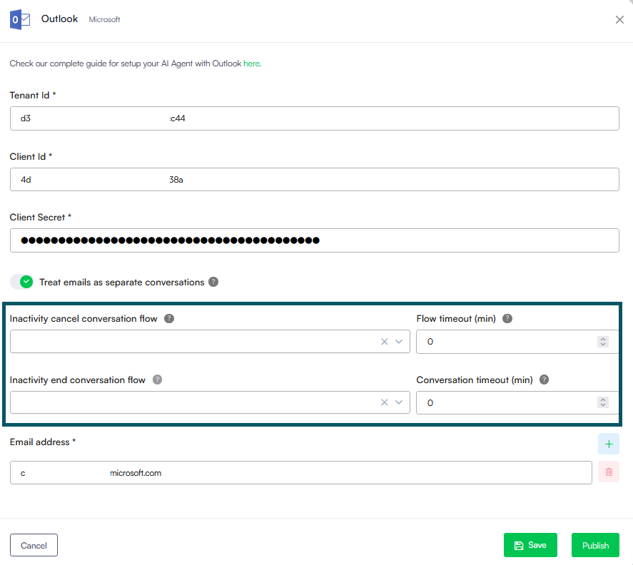

Deployment Dates

The table below lists the deployment date of Druid 9.25 across Druid Clouds. To view the Druid Releases Calendar, see [Druid Releases](<../Druid AI Releases.md>).

| Druid Cloud Community \*.community.Druidplatform.com | Druid Cloud US \*.us.Druidplatform.com | Druid Cloud Australia \*au.Druidplatform.com | Druid Cloud West-Europe (PROD) \*.Druidplatform.com |
| ---------------------------------------------------- | -------------------------------------- | -------------------------------------------- | --------------------------------------------------- |
| June 18, 2026                                        | July 02, 2026                          | July 02, 2026                                | July 02, 2026                                       |

These release notes give you a brief, high-level description of the improvements implemented to existing features.

If you have questions about your Druid tenant, please contact [support@Druidai.com](mailto:support@druidai.com) or your local Druid partner for more information.

**Recommended!** This release includes features that require upgrade of your Druid Connector Host:

* REST Custom Authentication with JWT Assertion

## What's New

* **Chart Authoring with AI**. We are excited to introduce AI-assisted chart authoring to streamline your visualization workflows! Available in this release, this capability transforms your visual data requirements into functional chart configurations through guided chat interactions. By leveraging conversational AI, you can significantly reduce manual configuration effort and accelerate the chart creation process.

Create chart from scratch

Fine-tune existing charts

For more information, see [AI Authoring Agents](https://druidai.gitbook.io/druid-ai-docs/build-ai-agents/ai-authoring-agents).

## Improvements

* **Druid SIP Improvements**. This release introduces significant enhancements to the Druid SIP, which connects external telephony systems to your voice-enabled AI Agents. These updates are designed to simplify your platform setup workflows and streamline authoring for live voice interactions.
* **Reorganized Configuration Layout**. The Druid SIP settings interface has been restructured into logical, intuitive tabs (General, Call Settings, and Speech). This makes managing your telephony trunk parameters faster and more organized.
* **Streamlined Allowed IPs Management**. Managing authorized signaling addresses from your telephony provider is now easier than ever. The updated interface introduces a clean, structured table configuration with dropdown menus for flexible matching types alongside direct inline editing and port mappings.

* **Language Detection for Speech-to-Text (STT)**. Voice recognition capabilities have been expanded. The Speech-to-Text configuration now supports automatic language detection modes (At Start or Continuous), allowing your voice AI Agent to intelligently track or adapt to the language spoken by the caller during the call.

* **Native Call Recording Support**. You can now capture and store raw audio recordings of voice interactions directly through the platform.

* **Dedicated Voice Interaction improvement in the Conversation History**. You can now access detailed call transcripts, view precise caller/callee metadata and operational performance metrics, and access audio recordings—complete with interactive playback controls, visual audio waveforms, and direct download links.

For more information, see [Configure Druid SIP Connectivity](https://druidai.gitbook.io/druid-ai-docs/druid-voice/druid-sip/configure-druid-sip-connectivity) and [Voice Conversation History](https://druidai.gitbook.io/druid-ai-docs/druid-voice/druid-sip/voice-conversation-history).

* **Speech Synthesis Markup Language (SSML) Support for Voice-Enabled Flows**. We have expanded the capabilities of the Voice settings within flow steps to give authors total control over how AI Agents sound during voice interactions. The **Speak message** fields on flow steps now natively accept and forward SSML strings directly to your configured Text-to-Speech (TTS) engine (such as Azure Speech Services or AudioCodes channels).

Instead of relying on rigid, flat text conversions, conversation authors can now leverage xml-based SSML tags directly inside flow steps to explicitly manipulate:

* **Prosody & pacing**. Adjust vocal pitch, volume levels, and precise speaking speed (e.g., slowing down when reciting account digits).
* **Natural pausing**. Inject deliberate silence gaps between distinct options to improve caller comprehension on phone menus.
* **Emotional expressions**. Apply distinct speaking styles (such as cheerful, empathetic, or customer-service personas) supported by your neural voice provider to better match the context of the user interaction.

For more information, see [Voice](https://druidai.gitbook.io/druid-ai-docs/build-ai-agents/authoring-tools/flows/conversational-flows/flow-steps/common-flow-settings/voice).

* **Outlook Channel-Specific Inactivity Management**. Managing long-form, asynchronous conversations over email requires a much different pacing than instant live chat. We have introduced independent, channel-level conversation lifecycles and inactivity timeouts for the Outlook channel to give you complete control over email-driven interactions. For more information, see [Outlook](https://druidai.gitbook.io/druid-ai-docs/channels/web-and-email/outlook).

* **Code Extension - Programmatic Business Exception Handling**. We have introduced the `Context.RaiseError()` method to the Code Extension to unify business logic validations with technical exception paths within the Flow Engine. By programmatically triggering an exception when custom business rules fail, the method eliminates the need for complex, branched visual routing in the Flow Designer. Instead, it automatically intercepts the failure and dynamically routes the conversation down your existing exception configuration—either directly following the step-level **Error Handler** path or falling back to the **Exception flow** configured in the AI Agent Dialogue Management settings. For more information, see [Context.RaiseError](https://druidai.gitbook.io/druid-ai-docs/build-ai-agents/authoring-tools/flows/conversational-flows/flow-steps/common-flow-settings/code-extension#Context.).
* **REST Custom Authentication - Custom Code**. Added support for Custom Code in the **Authenticate Client connector action**. You can use the Custom Code task to perform advanced processing directly before triggering the **Authenticate Client** integration task—such as Server-to-Server authentication with JWT Assertion by locally generating a signed, short-lived cryptographic assertion using custom claims, RSA signatures, or custom JWT headers, storing the assertion in a context variable, and passing it to the authentication endpoint. For more information, see [Advanced Dynamic Authentication](https://druidai.gitbook.io/druid-ai-docs/integrations/enterprise-connectors/rest/rest-apps/custom-authentication/advanced-dynamic-authentication) and [JWT Assertion Authentication Examples via Custom Code](https://druidai.gitbook.io/druid-ai-docs/integrations/enterprise-connectors/rest/rest-apps/custom-authentication/advanced-dynamic-authentication/jwt-assertion-authentication-examples-via-custom-code).
* **Improved \[\[SystemError]] Message**. Enhanced the **\[\[SystemError]].Message** field to include both the primary error message and any additional error details returned by the system. This provides AI Agent authors with more complete diagnostic information, making troubleshooting and automated exception handling easier and more accurate. For more information, see [\[\[SystemError\]\]](https://druidai.gitbook.io/druid-ai-docs/build-ai-agents/authoring-tools/ai-agent-informational-model/system-entities#\[\[System).
* Druid Conductor **Explainability**. We are excited to extend Explainability to the Druid Conductor level. Previously available only for individual AI Agents, Explainability now provides a centralized, end-to-end view of how the orchestration layer interprets, routes, and processes user requests.

For more information, see [Explainability and Utterances Annotation](https://druidai.gitbook.io/druid-ai-docs/ai-governance-and-security/observability-and-explainability/explainability-and-utterances-annotation#ExplainabilityatDruidConductorLevel).

* **Knowledge Base - New Standard PDF Extractor**. Starting with this release, the advanced PDF extraction engine previously available as **Elpis** is the new **Standard** and is automatically selected for all newly created Knowledge Bases. This change simplifies extractor selection while ensuring users benefit from improved document parsing capabilities, including support for multimedia-rich PDFs, image extraction, and more accurate processing of complex document structures. The previous Standard extractor remains available as **Standard (Deprecated)** to ensure backward compatibility with existing configurations. For more information, see [File Extractors](https://druidai.gitbook.io/druid-ai-docs/knowledge-base/knowledgebase/kb-advanced-settings/file-extractors#PDF Extractors).


**Info:** Existing Knowledge Bases retain their current PDF extractor configuration. To view the updated extractor names in the PDF extractor drop-down, reset the Knowledge Base advanced settings.


* **Enhanced Advanced Data Editor for Charts**. To give authors more control and visibility when customizing charts, we have redesigned the advanced chart editor experience. The JSON field formerly known as the **Advanced Editor** has been renamed to the **Advanced data editor** and upgraded from a single JSON field to a dual-pane interface:
* **Default Query** (Readonly): Displays the current chart data query for easy reference.
* **Custom Query** (Editable): Select **Custom Query** and input your own custom code. This allows you to tailor chart configurations and advanced behaviors exactly to your preferences. For advanced customization, you can directly implement standard Chart.js configurations and documentation samples.

