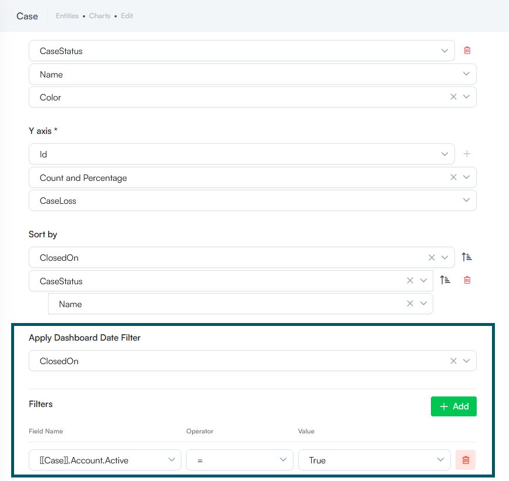

Deployment Dates

The table below lists the deployment date of Druid 9.31 across Druid Clouds. To view the Druid Releases Calendar, see [Druid Releases](<../Druid AI Releases.md>).

| Druid Cloud Community \*.community.Druidplatform.com | Druid Cloud US \*.us.Druidplatform.com | Druid Cloud Australia \*au.Druidplatform.com | Druid Cloud West-Europe (PROD) \*.Druidplatform.com |
| ---------------------------------------------------- | -------------------------------------- | -------------------------------------------- | --------------------------------------------------- |
| September 10, 2026                                   | September 24, 2026                     | September 24, 2026                           | September 24, 2026                                  |

These release notes give you a brief, high-level description of the improvements implemented to existing features.

If you have questions about your Druid tenant, please contact [support@druidai.com](mailto:support@druidai.com) or your local Druid partner for more information.

**Recommended!** This release includes features that require upgrade of your Druid Connector Host:

* **REST Apps - Simplified Client Certificate upload**

## What's New

* **Druid Voice – New Features**. This release brings powerful new features:
* **Speech-to-Speech (General Availability)**. Druid Voice Speech-to-Speech delivers a real-time, low-latency vocal interaction experience with response times under one second. Built for fluid, natural conversations, this technology preview introduces advanced capabilities designed for high-performance voice interactions.

Experience the speed yourself! [Speak with Nova](https://cmgbh04.na1.hubspotlinks.com/Ctc/W1+113/cMGbh04/VWWmxx3kkms3W57rNFQ6YrRjWW2L--MX5Tqv9jN2SX2503qn9qW95jsWP6lZ3nNW7X8bvk2wZpfnW3KlWj82BwbdxN8f8dhyWL-q0W8pClq36c2V7LW5pJtZF4gxZ6GW5lfLWm5sR657W27WBhC8vPdRxW1HdZ4g7x9gm3W79HNtG6M4GhJW2mV5jr79cylwW65_24z25JRVDW3Ctjdy7f_LZqW41Fln05VbmD2W35Rf_58B5dKhW8dHf1x7CR4mYW3JctPt1CnxzWW2FW1D-82y0GPW7vBmBr2MwsNqVLSLS544mRHrW68Y0Nd10rLLxW2RhWm_2zgQP_W2ccCV338Tyy9W3QFXyd84y8qhW8WTqZW5vFrRGW32rGVp7MyP5MW1Xs3g91S6MszW9cwRx62f973LW815THL3sgWjRW7J_syz5DZhXkW70jHL65BFlnnf1-yzJF04), our healthcare demo AI Agent, and feel sub-second voice interactions in action.

* **Centralized Speech Resource Management and Governance**. You can now centrally define, configure, and manage speech resources (STT and TTS) at the tenant level under Administration > Speech Resources. This central repository simplifies vendor setup and security governance, allowing speech resources to be reused seamlessly across Druid Voice channels without redundant configuration.


**Info:** Centralized speech resource management is currently supported for the Druid SIP channel. Support for the Webchat channel will be introduced in an upcoming release.


For more information, see [Speech Resource Management and Governance](https://druidai.gitbook.io/druid-ai-docs/druid-voice/speech-resources/speech-resource-management-and-governance).

*   **Speech Resource Metrics**. A dedicated **Metrics** tab is available under **Administration** > **Speech Resources** to deliver real-time operational analytics for speech services used in the Druid SIP channel. You can track key operational metrics over custom time horizons, including total transcribed audio minutes, synthesized word volume, and average response delays (STT/TTS latency in milliseconds). This enables proactive latency bottleneck detection, and performance benchmarking between speech providers.

    

    For more information, see [Speech Resources Metrics and Usage Monitoring](https://druidai.gitbook.io/druid-ai-docs/druid-voice/speech-resources/speech-resources-metrics-and-usage-monitoring).
* **KB Metadata - Native KB experience**. KB Metadata management has shifted from web views and forms to a fully native Knowledge Base experience, eliminating the requirement to import the KB Toolkit solution template.
* **Simplified KB Metadata Setup**. You no longer need to build or maintain complex forms and views. Simply register your nomenclatures directly under **Knowledge Base Settings** > **Metadata Integrations**, then assign them on data source nodes by selecting the desired KB field from a dropdown.

- **Custom Data Source Support**. You can now define KB metadata programmatically within the Custom Code task of custom data source extraction integrations (`responseEntity.Node.Context.Metadata`).


**NOTE:** To support a seamless transition, data source tree elements (roots, nodes, and leaves) will display two tabs through version 10.1: **Metadata** (legacy experience) and **Metadata (New)** , allowing you to validate the new setup alongside existing configurations.


For more information, see [KB Metadata](https://druidai.gitbook.io/druid-ai-docs/knowledge-base/knowledgebase/advanced-features-and-optimization/kb-metadata).

## Improvements

* **Druid Voice Improvements**. This release introduces key updates for the Druid SIP channel:
* **Munsit speech provider support**. Druid SIP now natively supports Munsit for both Speech-to-Text (STT) and Text-to-Speech (TTS) capabilities. Munsit is an Arabic-first voice AI platform specifically engineered from the ground up for regional performance. Unlike global providers that often struggle with regional nuances, Munsit delivers targeted capabilities for Middle Eastern enterprise deployments and government organizations—including high accuracy across Arabic dialects, support for mixed Arabic–English code-switching, and full compatibility with regional UAE endpoints for strict local compliance and data sovereignty. For information on how to add Munsit speech resources, see [Speech Resource Management and Governance](https://druidai.gitbook.io/druid-ai-docs/druid-voice/speech-resources/speech-resource-management-and-governance).
* **SIP User-to-User Information (UUI) header support on call transfers**. Druid SIP now supports passing custom metadata during call transfers in compliance with IETF RFC 7433. Context parameters stored in context (such as uuiHeader, uuiPurpose, and uuiContent) are automatically encoded and passed inside the `Refer-To` header during a SIP REFER transfer, allowing downstream contact centers to receive critical transfer context without requiring caller repetition. For more information, see [Blind Transfer via SIP REFER](https://druidai.gitbook.io/druid-ai-docs/druid-voice/call-routing/transfer-calls#Blind).
* **LLM Streamer - Reasoning Feedback for Voice Interactions**. With this release, you can stream the model's internal thinking process as temporary Informative Messages during active processing by setting sendReasoningMessage: true in the LLM Streamer advanced configuration. Temporary status updates provide real-time operational feedback while the model synthesizes its final response, keeping voice interactions responsive.

For more information, see [Use LLM Response Streaming for Voice Interactions](https://druidai.gitbook.io/druid-ai-docs/build-ai-agents/authoring-tools/flows/agentic-flows/use-llm-response-streaming-for-voice-interactions).

* **REST Apps - Simplified Client Certificate upload**. Configuring client certificate security for REST apps using the **Local Folder** store type has been streamlined. Authors can now upload the certificate file directly within the interface. Upon upload, Druid automatically populates the **File Name** field and sets the **Certificate Store Type** to **Local Folder**. This eliminates the need to manually manage and copy shared file paths, reducing configuration errors and speeding up secure mTLS setup.

For more information, see [Client Certificate Security](https://druidai.gitbook.io/druid-ai-docs/integrations/enterprise-connectors/rest/rest-apps/client-certificate-security).

* **Enhanced Chart Filtering & UI Updates**. This release brings two new improvements:
* **Chart filtering**. You can now filter chart data by specific entity fields directly within the chart configuration page, mirroring the filtering experience available for data service integration responses.
* **Renamed the 'Filter By' setting**. With the introduction of the new dedicated **Filters** section, the existing **Filter By** field has been renamed to Apply Dashboard Date Filter to prevent confusion. Its core functionality remains completely unchanged.

For more information, see [Dynamic Charts](https://druidai.gitbook.io/druid-ai-docs/conversational-ai-apps/charts/dynamic-charts).

* **Automatic microphone disabling on blocked user input**. To enforce strict user choices during AI Agent interactions, setting a step to block user input now automatically disables the Webchat microphone capability for that specific step. Previously, users could bypass choice button restrictions on Choice, Hero, or Thumbnail steps by speaking via Speech-to-Text. With this update, voice input is deactivated whenever user text input is rejected, ensuring users must select one of the predefined options.

## Bug Fixes

* **Telegram Channel Fix**. Resolved an issue where Telegram users could not view Hero card subtitles or preceding step messages. Hero cards on Telegram now correctly render the step message, Title, Subtitle, and Description as configured in the flow builder.
* **Agentic Integration Settings Preservation**. Fixed an issue where importing a solution containing an Agentic integration into a target tenant reset the integration type properties to false. Importing solutions now correctly retains and preserves the Agentic flow type settings across environments without manual reconfiguration.
* **Solution Import Fix - Disabled Flow Status Preservation**. Resolved an issue where importing a solution containing a disabled flow automatically re-enabled it in the target environment. The **IsDisabled** flow configuration property is now correctly preserved during solution export and import, ensuring disabled flows remain inactive upon deployment.
* **Knowledge Base Image Link Expiration Fix**. Fixed an issue where expired image links returned from Knowledge Base responses were reactivated and accessible again whenever a new response referenced the same Knowledge Base chunk. Image links now remain strictly expired and inaccessible after their 30-minute validity window, maintaining proper access controls regardless of subsequent query activity.
* **Automation Display Name Fallback**. Fixed an issue where automations were not visible when the default language was set to something other than en-US. Automations now correctly display the Name/Display Name for the active tenant language. If the tenant language is not explicitly configured for the AI Agent, Druid now reliably falls back to the display name defined in the AI Agent's default language instead of hiding the automation.
* **GetIntentMatching Logic Fix**. The **GetIntentMatching** internal action bypassed exact phrase matching and sent all input directly to ML services for prediction. It now checks for exact intent matches—including commands (e.g., `!command`)—first, and triggers an ML prediction request only if no exact match is found.
