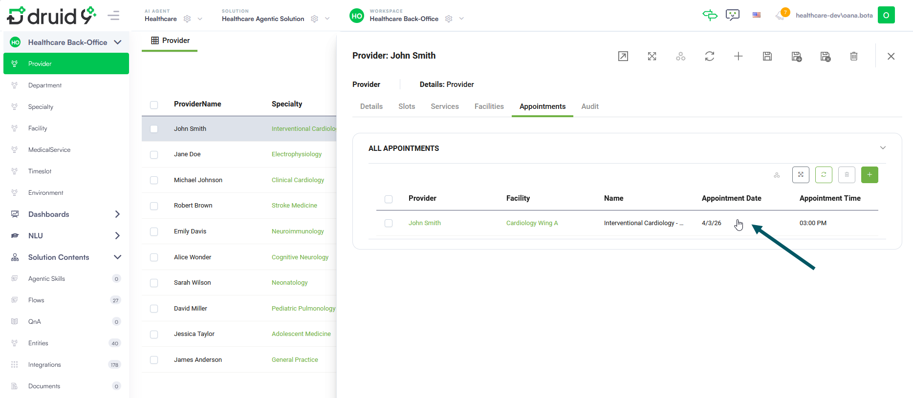

For medical providers

The Appointment Management workspace allows medical staff to manage the Complete Appointment lifecycle. This ensures that every patient visit is tracked from the initial booking through to the final completion.

## Understanding Appointment Status

The system automatically tracks the following statuses:

* **New**: A scheduled appointment awaiting action.
* **Confirmed**: An appointment verified by the patient or staff.
* **Completed**: A successfully finalized medical visit.
* **Canceled**: An appointment that was canceled.
* **Rescheduled**: An appointment that was rescheduled.
* **No Show**: Automatically assigned by the system at the end of the day or at a specific time configured by the solution administrator if a visit was not honored.

## Completing an Honored Appointment

Medical staff and doctors should perform the following steps only when a patient has honored their appointment:

1. Select the **Appointment Management** workspace.
2. Click **Appointment** on the workspace menu.
3. Select the appointment with status 'New' which the patient honored.

4. The appointment form opens.
5. Click the **Complete Appointment** button at the top right corner of the form.

6. The Chat window opens on the right to inform that the appointment was successfully completed.

This action signifies the medical staff / doctor has successfully provided the service and the visit is officially honored.

7. Close the chat window, then close the form.

You can disregard the unhonored appointments , as the system will automatically mark their status to 'No Show' at the end of the day or at a time set by the administrator.

## Triggering Proactive Voice Calls

Medical staff can manually initiate specialized voice AI Agents to reach out to patients directly. This proactive engagement is managed through the Automations icon available within the dedicated workspaces. Once triggered, the AI Agent calls the patient immediately to complete the assigned task.

### Trigger Recovery Follow-Up Call

After a patient completes a procedure, you can initiate a recovery follow-up call to ensure continuity of care. The AI Agent acts as a warm, empathetic assistant that performs the following actions:

* **Check wellbeing**. Asks the patient how they are feeling post-procedure.
* **Record vitals**. Captures pain levels on a scale of 1–10 and notes any reported symptoms.
* **Provide guidance**. Offers general safety instructions to the patient.
* **Update care team**. Saves a summary of the interaction directly for medical staff review.

To trigger a recovery follow-up call for a completed appointment, follow these steps:

1. Select the **Appointment Management** workspace.
2. Click **Appointment** on the workspace menu.
3. Select the specific appointment for which you want to initiate the follow-up.
4. On the appointment form, click the **Automations** icon and select **Recovery Follow-Up**.

Once triggered, a warm and empathetic assistant calls the patient to check on their wellbeing, record pain levels and symptoms, and provide general safety guidance.

### Trigger Appointment Confirmation and Late-Arrival Management

To reduce no-show rates and manage clinical schedules effectively, use the Appointment Reminder to verify upcoming visits. This automation enables the AI Agent to handle various patient scenarios:

* **Attendance confirmation**. Confirms whether the patient is able to attend their scheduled appointment.
* **Late-arrival logging**. If a patient reports they are running late (up to 15 minutes), the agent notes this for the clinic staff.
* **Automated rescheduling**. If the patient cannot attend, the agent automatically guides them through the Rescheduling Flow to find a new time slot.

To initiate a confirmation call for an upcoming appointment, follow these steps:

1. Select the **Healthcare Back-Office** workspace.
2. Click **Provider** on the workspace menu.
3. On the provider form, click the **Appointments** tab.
4. Select the specific appointment for which you want to initiate the confirmation call.

5. On the appointment form, click the **Automations** icon and select **Appointment Confirmation Reminder**.

.png>)

Once triggered, the AI Agent calls the patient immediately.
