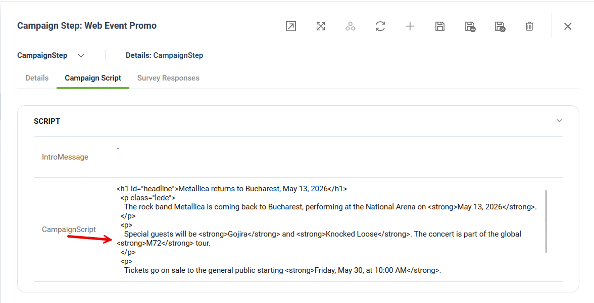

The **Targeted Outreach Agentic Solution** is an extension of the [Campaign Management Agentic Solution](<Campaign Management Agentic Solution.md>), developed to allow campaign managers to send targeted promo / advertising content to the user chat sessions. The solution takes advantage of LLM integration to analyze the user discussions and deliver them the best matching marketing content. Furthermore the solution works both as an add-on to the existing Campaign Management App, sharing the same data model, or as a standalone application.

The marketing content is delivered automatically after a preset number of minutes of user inactivity.

## Key Components

The key components of this solution include:

* **Backend Management** - Define and manage Marketing Campaigns with HTML content.
* **Preloaded Sample Data** - Preloaded sample data for Backend tables (Statuses, demo Campaigns, etc.) and an automated setup flow that provisions these tables.
* **Campaign Delivery Flow** – The main business flow that delivers the best matching marketing campaign to each user and logs each message delivery for campaign analysis.

## Prerequisites

* Tenant Druid community (open new tenant [here](https://www.druidai.com/license-activation)) or Druid subscription.
* You should have a AI Agent. For information on how to create an AI Agent, see [Creating AI Agents](https://druidai.gitbook.io/druid-ai-docs/ai-platform/build-ai-agents/authoring-tools/creating-ai-agents).

## Configuring the Skill Template

To configure the skill template, follow these steps:

### Step 1. Install the solution from the Solutions Library

Go to the Solutions Library, search for solution "Targeted Outreach Agentic Solution" and import it following the instructions provided in section [Installing Solution Templates](<../../Installing Solution Templates.md>).

Wait until the import status shows as “Success”.

### Step 2. Set up the AI Agent special flows

Go to the AI Agent settings, Details page and click the Dialog management section header. The section expands. Select the following special flows:

| Special Flow                     | Select                   |
| -------------------------------- | ------------------------ |
| Inactivity end conversation flow | deliver-campaign-message |

Set the **Conversation timeout (min)** parameter to the desired value. This parameter sets the number of minutes of user inactivity after which the campaign delivery flow, set up above, will be triggered.

Scroll down and click **Save & Close**.

### Step 3. Configure the app connection

To configure the app connection, follow these steps:

1. Go to **Administration** > **Druid Services**.
2. Copy the claims and token corresponding to the DRUID-LLM resource you want to use — you’ll need them to configure the app connection.


**NOTE:** If the DRUID-LLM resource does not appear, contact your sales representative to activate DRUID-dedicated resources for one of the following providers on your tenant: Azure OpenAI, Mistral, or Google.


3. Go to **Solution Contents** > **Apps** and select the **DRUID-LLM** app.
4. In the **Base URL** field, paste the claims value you copied at step 2.
5. In the Variables table, enter the token you copied at step 2 as the key.
6. Click **Save** to complete the configuration.
7. Once the app is configured, click **Publish**.

### Step 4. Import default settings

1. Select the **Marketing Admin** workspace.
2. Click **Campaign Settings** on the workspace menu.
3. Click the **Import Settings** button.

This automation provisions the default app settings.

### Step 5. Verify Demo Data

Review all demo data in the **Marketing Admin** workspace.

You can now build and test your first marketing campaign.

## Building your first campaign

To build your first campaign, select the **Marketing** workspace and follow these steps:

1. On the workspace menu, click **Campaigns**.
2. Click the **New Record** icon in the top-right corner. This opens the Campaign creation page on the **General** tab.
3. Add the campaign details (**Name** and **Description**) and select the campaign **Status** (Active) and the **Campaign Type** (Marketing).
4. Select the **Start** and **End date**.

5. Save the campaign general details.
6. Click on the **Campaign Steps** tab, and add one or two steps for all the Channels that the Campaign is targeting. To add a campaign step, follow these steps:
7. Click the **Add** icon. The CampaignStep configuration page appears.
8. Specify the desired **Channel** (Directline).

3. Click the **Save** icon.
4. Click the **Campaign Script** tab and fill in the Campaign message that will be delivered to all users. You can also add HTML code for a rich-format message.

5. Click the **Save\&close** icon.
6. Click the **Save** icon to save the campaign.

The Campaign is now configured and ready to run.

For each Campaign you can check the total number of messages that were delivered in chat conversations in the **Engagement** tab.

