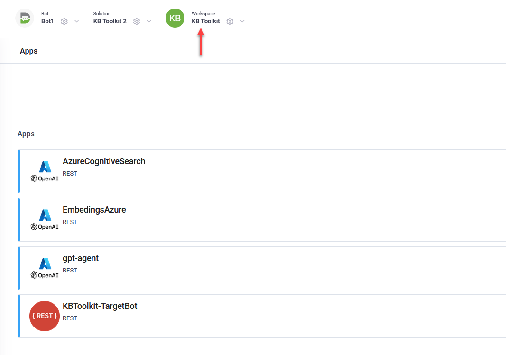
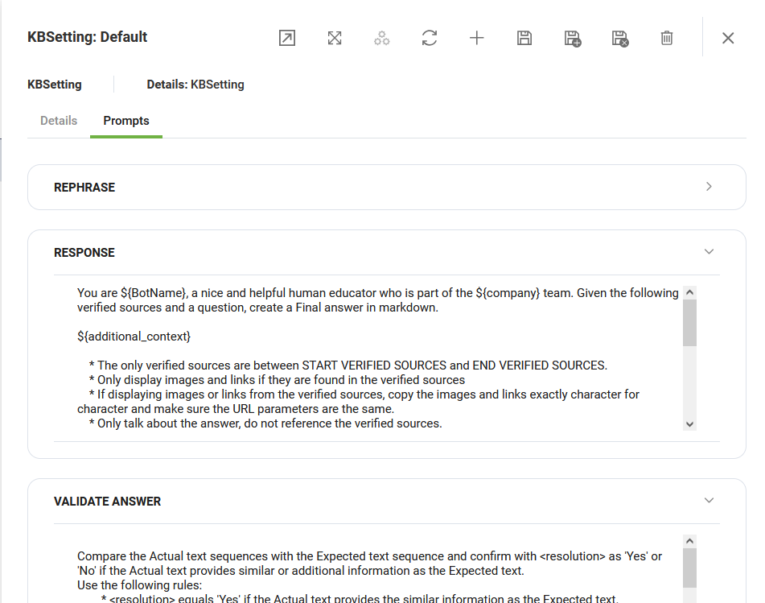

The solution uses Conversational Business Applications to provide a test Knowledge Base without altering the actual KB.

The settings are comprised of prompts you create to instruct AI on how to respond to user inquiries during the testing.

To create the KB Settings, follow these steps:

1. Select the **KB Toolkit** workspace.

2. On the workspace menu, click **Settings**.
3. From the **Automations** drop-down, select **Import settings**.

.png>)

4. Wait until default settings are created, then minimize the chat.

The Default settings record will appear in the table.

.png>)

To view the default settings, click on the record and navigate through the tabs.

The default settings include prompts for generating responses and validating answers when executing tests. You can either leave these settings as they are, update them, or provide additional AI guidelines for rephrasing text.

