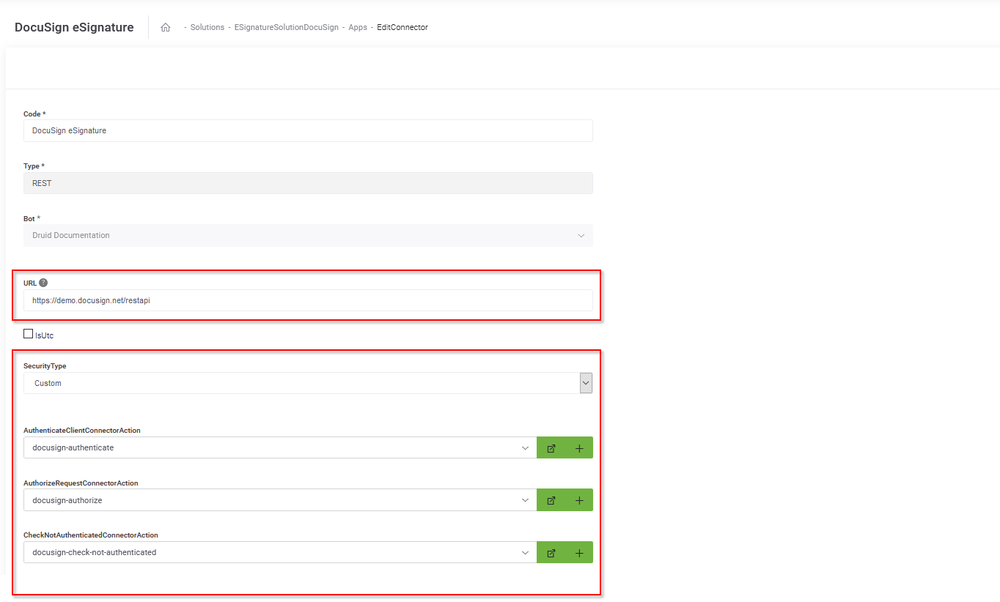
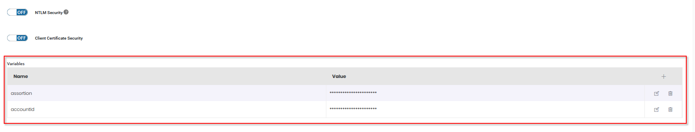

eSignature DocuSign is a solution that uses DocuSign technology to provide your AI Agent with electronic signature capabilities. Use it if you want to showcase Druid-DocuSign integration.

The solution template contains:

* DocuSign setup for two signers. The type of signature is Click2Sign with authentication via PIN Code.
* Sample conversation available in EN-US to collect data for the first and second signer (first name, last name, email address).
* Sample document template to be signed. If you want to use another document template, you should generate it from your DocuSign organisation.
* DocuSign Api V2.1 and full management of docusign-Druid integration services like: upload file to docusign, generate file, get signature url, get envelope status or download documents).

## Why choosing eSignature DocuSign?

By integrating with DocuSign, the electronic signature of a digital document can be done through any AI Agent, in any scenario, such as: at the point of sale, at the point of service, mobile sales, customer onboarding, KYC, contract management, remote signing (employees working remotely or working from home), or internal document signing.

The AI Agent will automatically apply to any document the electronic signature type specific to the internal flow, role and user rights (standard, advanced or qualified electronic signature). The digital documents are archived electronically, carrying advanced timestamps, in full compliance with Romanian, European and international laws.

You can read more about DocuSign services [here](https://www.docusign.com/products/electronic-signature).

## How to set up eSignature DocuSign

**Prerequisites**:

* You need to have a DocuSign subscription (either demo or production account).
* In the DocuSign Platform, generate a new JSON Web Token (JWT) by following the first two steps described in [DocuSign documentation](https://developers.docusign.com/platform/auth/jwt/jwt-get-token/). Copy the JWT, you will need it in Druid to authenticate the requests.
* In the DocuSign Platform, go to **Apps and Keys** and copy your API Account ID, you will need it in Druid to authenticate the requests.

To set up the REST connector used for electronic signature of documents:

1. From solution Apps, click **DocuSign eSignature**. The Edit Connector page appears.
2. In the **URL** field, enter the URL of your DocuSign environment.
3. From the **SecurityType** drop-down, select **Custom**.
4. From the **AuthenticateClientConnectorAction** field, select **docusign-authenticate**.
5. From the **AuthorizeRequestConnectorAction** field, select **docusign-authorize**.
6. From the **CheckNotAuthenticatedConnectorAction** field, select **docusign-check-not-authenticated**.
7. In the Variables section, add the two variables as follows:

* **assertion** - the JWT you generated in the DocuSign Platform.
* **accountId** - the API Account ID you copied from the DocuSign Platform.

8. Click **Save and Close**.

After you finish the setup, you need to train the AI Agent.

## Train the AI Agent

In the AI Agent configuration page, click the **Details** tab, and then click the NLP section header. The NLP area expands. Scroll down to the Train area and click the **Train** button.


**NOTE:** It might take a few minutes for the NLP training to complete, so you might need to wait for Druid to finish training all AI Agent entities that have NLP enabled (NLP=true).


You can start chatting with the AI Agent by saying things like "send documents to sign" or " get signature".
